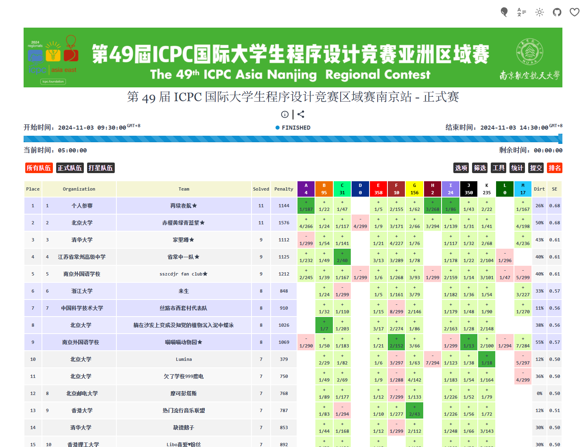
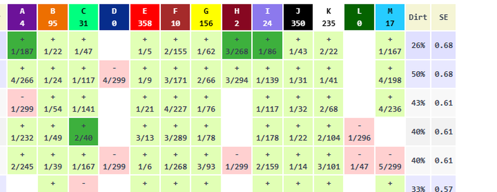
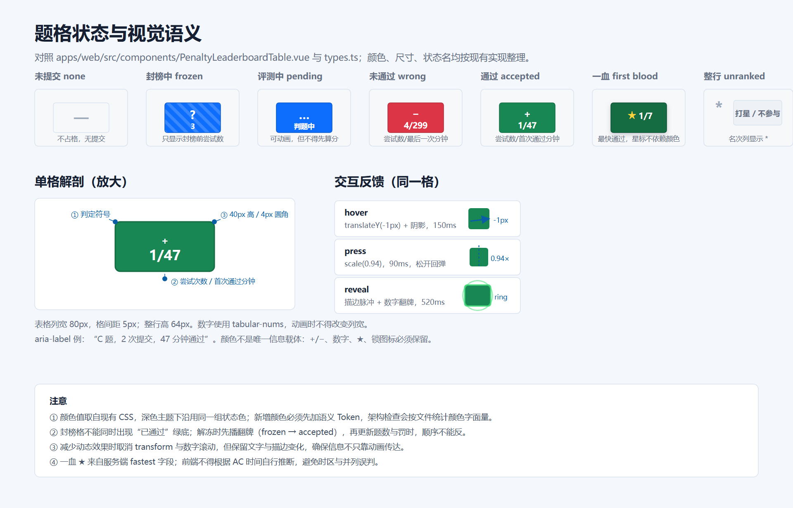
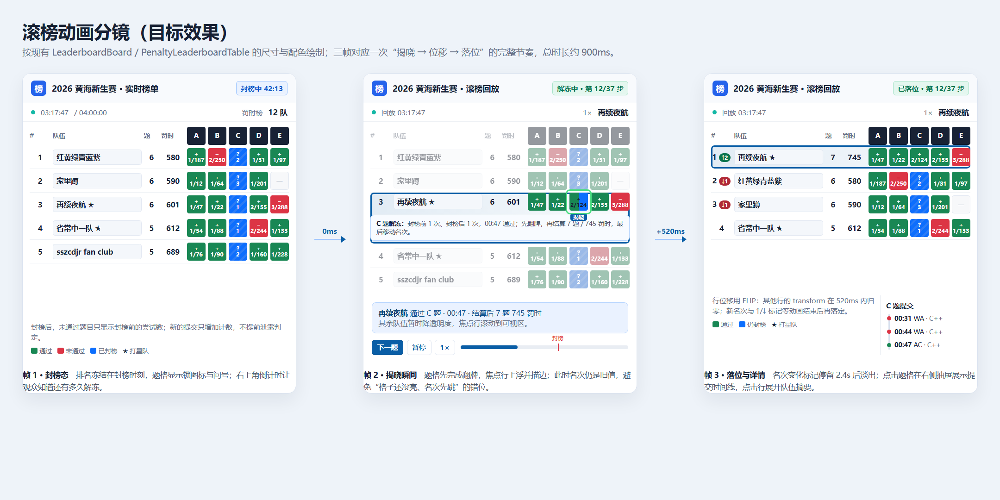
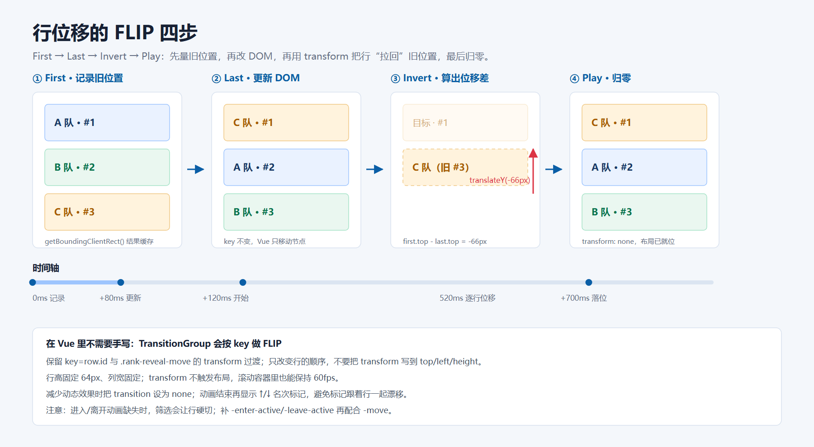

# ICPC/CCPC 榜单与滚榜动画开发方案

本文给出在现有黄海 OJ 上实现 ICPC/CCPC 风格榜单的完整开发方案，覆盖数据与排名口径、封榜/解冻状态机、行与格两级动画、滚榜播放器、行展开与提交时间线，以及可以直接照做的文件拆分、代码骨架、测试和验收口径。文档以当前工作树为准，先写“现状事实”，再写“目标做法”；未实现的部分一律标注“待实现”，不把设计写成已完成。

适用页面：考试榜单、团队比赛榜单、比赛后台评审榜单，以及管理员赛后滚榜弹窗。三处共用 [`LeaderboardBoard.vue`](../apps/web/src/components/LeaderboardBoard.vue)，因此动效只做一层，不要为每个页面复制。

阅读路径：

| 目标 | 先看 |
| --- | --- |
| 只做 P0 动画（不改后端） | 第 3、6、7、10.1 节 |
| 核对罚时/封榜/权限/接口 | 第 4、5 节 |
| 做逐提交滚榜 | 第 5.4、9 节 |
| 做测试与验收 | 第 11、12 节 |
| 找参考截图/示意图 | 1.2、3.4、3.5 与 `docs/assets/scoreboard/` |

## 1. 目标、范围与视觉基线

### 1.1 用户可感知的目标

1. 实时榜与封榜榜都能一眼看出“哪些格子被冻住、哪些是真实结果”，封榜期间不泄露封榜后的 AC。
2. 管理员打开滚榜后，按“当前最低名次的待揭晓队伍”逐题解冻，题格翻牌、行平滑移动、题数/罚时数字补间、名次变化标记依次出现。
3. 点击行展开队伍摘要，点击题格打开该题的提交时间线；桌面与手机都可操作，键盘可用。
4. 所有动画尊重 `prefers-reduced-motion`，关闭动画后信息仍然完整可读。
5. 不引入动画库、不改变服务端排名与脱敏规则。（榜单定时刷新后来按需求加入，现行规则见 [场次文档](events.md)。）

### 1.2 视觉参考

下面这张是第 49 届 ICPC 南京站正式榜的公开截图，用作“信息密度、题格写法、状态颜色”的参照。截图来源为 [XCPCIO Board](https://board.xcpcio.com/icpc/49th/nanjing)，版权归原站，仓库内仅作视觉参考。



从这张榜里可以确认四个关键写法：

| 观察 | 本项目的对应 |
| --- | --- |
| 每格上方是 `+` 或 `−`，下方是 `尝试次数/首次通过分钟`；未通过格显示 `尝试次数/最后一次提交分钟`。 | 与 [`PenaltyLeaderboardTable.vue`](../apps/web/src/components/PenaltyLeaderboardTable.vue) 的 `primary/secondary` 完全同构，直接沿用。 |
| 题头是“字母 + 通过数/提交数”，颜色按题号循环。 | 与现有 `problem.color`、题头 `solved/attempted` 一致，不要另起一套。 |
| 深绿色格通常用于强调“最快通过”（一血），队名后的 `★` 表示打星队，两者含义不同；具体以该站点的图例为准。 | 本项目用服务端 `fastest` 表示一血；打星/不参与排名用 `unranked` 表示，前端不得把两个星混用。 |
| 名次、题数、罚时三列固定，题格横向滚动，表头跟随。 | 现有 64/180/72/88/80px 列宽与表头 `translate3d` 同步已经实现，不要重写。 |

题格细节放大：



本项目要补的是“格子级状态变化”和“行级位移动画”，不是重新画一张表。

### 1.3 不在本次范围

| 不做 | 原因 |
| --- | --- |
| 重写服务端排名/罚时算法 | 服务端是唯一事实源，前端重算只用于回放展示，且必须与 `final_rows` 对账。 |
| 榜单 WebSocket 推送 | 60 秒静默刷新已满足需求，规则见 [`ranking-refresh.test.ts`](../apps/web/tests/ranking-refresh.test.ts)；推送需要额外的连接与扇出设计。 |
| 新开一套榜单表格 | 现有两张表、四个宿主、单测与 e2e 都绑定在现有 DOM/类名上；动画只能加类、加属性、加内联 CSS 变量。 |
| 引入 GSAP/Framer/动画库 | 入口包体预算 250 KiB gzip，新增依赖会触碰预算与评审；现有 `TransitionGroup` + CSS + 少量 rAF 足够。 |
| 让非管理员在封榜期拿到真实结果 | 封榜脱敏在服务端完成；前端任何“猜结果”的实现都视为缺陷。 |
| 本次直接实现逐提交滚榜 | 现有 replay 只够逐题揭晓；逐提交需要后端契约扩展（第 9 节），先做前端可落地部分。 |

### 1.4 验收口径

沿用项目固定口径：桌面 `1440×1100`、手机 `390×844`，浅色与暗色都要看；榜单主题还有独立的“深色/马卡龙”切换；不能出现整页横向溢出；动画关闭后信息不能缺失。详细用例见第 11 节。

## 2. 现状盘点

### 2.1 组件与数据流

```text
ExamRanking.vue ─┐
ContestWorkspace.vue ─┼─> LeaderboardBoard.vue ─> PenaltyLeaderboardTable.vue（ACM）
CompetitionDetail.vue ─┤                          └> ScoreLeaderboardTable.vue（IOI/OI）
EventRankingReview.vue ─┘
ContestReplay.vue ─> createContestReplay() ─> LeaderboardBoard.vue（同一块榜单）
```

- [`LeaderboardBoard.vue`](../apps/web/src/components/LeaderboardBoard.vue) 是唯一外壳：标题、封榜标记、时间轴、筛选、主题、全屏、汇总、空态/错误态。
- 罚时榜与分数榜是两张独立组件，行都用 `key=row.id`，外层是 `TransitionGroup`，已有 `.rank-reveal-move { transition: transform 700ms ease; }`。
- 回放弹窗 [`ContestReplay.vue`](../apps/web/src/components/events/ContestReplay.vue) 复用同一块 `LeaderboardBoard`，用 750ms `setTimeout` 与 700ms 行位移手工对齐。
- 数据适配在 [`adapters.ts`](../apps/web/src/features/leaderboard/adapters.ts)，把两套后端结构统一成 `LeaderboardData`；回放引擎在 [`replay.ts`](../apps/web/src/features/leaderboard/replay.ts)。
- [`ContestWorkspace.vue`](../apps/web/src/views/teams/ContestWorkspace.vue) 每 15 秒刷新比赛详情；比赛榜和考试榜在进行中或等待评测时每 60 秒静默刷新，隐藏标签页时都暂停。

### 2.2 已经具备的能力

| 能力 | 位置 | 结论 |
| --- | --- | --- |
| 行级 FLIP | 两张表的 `.rank-reveal-move` | 已可用，700ms `ease`；行高固定 64px，不会触发布局。 |
| 题格 hover | `.penalty-result:hover` | 已有上浮 1px、阴影、饱和度反馈，150ms。 |
| 封榜标记 | `data.frozen` + `.scoreboard-freeze` | 有“排行榜已封榜”文字，只到榜单级，没有格级标记。 |
| 回放焦点行 | `data.revealUserId` + `[data-reveal-focus]` | 有 2px 描边；`revealProblemId` 已传到前端但表格从未消费。 |
| 回放引擎 | `createContestReplay` | 按 cell 差异逐题揭晓，能自动从最低名次队伍开始；总量、步数、最终快照都有。 |
| 筛选/主题/全屏/汇总 | `LeaderboardBoard` | 完整，动画不要影响这些入口。 |

### 2.3 缺口与问题

| # | 缺口/问题 | 证据 | 影响 |
| --- | --- | --- | --- |
| G1 | 没有格级揭晓 | `revealProblemId` 未被消费，格上无动画类 | 滚榜时只有整行滑走，看不出“哪一题刚解冻”。 |
| G2 | 没有数字补间 | 题数、罚时、总分都是文本直替换 | 名次变化时数字突然跳，观众跟不上。 |
| G3 | 没有名次变化标记 | 无 `prevRank` 记录 | 上升/下降只能靠肉眼比对。 |
| G4 | 回放只有步进 | `ContestReplay` 只有“下一题/从封榜开始/重新加载” | 不能播放、暂停、倍速、跳转，长比赛体验差。 |
| G5 | 不能点行/点格 | 表格无 click/keydown/tabindex | “查看某队/某题提交”没有入口。 |
| G6 | 分数榜封榜语义断裂 | `scoreStatus()` 不会返回 `frozen`；回放中未揭晓格显示红色“未满分” | IOI 回放看起来像“全错”，必须修。 |
| G7 | 回放事件是死字段 | `packet.events` 在 `replay.ts` 中从未读取 | 只能做逐题，做不了逐提交/按真实时间。 |
| G8 | 回放忽略参赛名单 | 后端 replay 把 `RankingUserIDs` 置空 | 有评奖名单时，回放的 `unranked` 与选手榜不一致。 |
| G9 | 未开封榜时滚榜为空 | `freeze == end` → `events=[]`、`initial==final` | 打开弹窗一步也走不了，需要空态文案或全量模式。 |
| G10 | 封榜期“没做”与“被封”同形 | 服务端按 cutoff 排除整行提交，cell 全零 | 无法显示“被封住 N 次”，回放只能前端合成 `frozen`。 |
| G11 | 回放与实时榜的排名口径可能不同 | 回放客户端重排，实时榜用服务端 `rank` | 同一队伍在两个视图里名次可能差一位，需对账与提示。 |
| G12 | 回放/榜单无实时推送 | 只有提交级 SSE | 榜单靠 60 秒静默刷新；动画在数据刷新或回放步进时发生。 |

### 2.4 工程硬约束

| 约束 | 具体要求 |
| --- | --- |
| 构建门禁 | `npm run build` = `api:check` → `vue-tsc --noEmit` → `vite build` → 入口包体检查。任一失败即构建失败。 |
| 颜色预算 | 新增 `.vue` 文件里出现任何 `#hex`/`rgb()/rgba()` 字面量都会让架构检查失败；新颜色写进 [`tokens.css`](../apps/web/src/styles/tokens.css)，组件只用 `var(--…)`/`color-mix`。 |
| 请求 | 业务代码只能走 `generatedApi`，禁止 `axios`/`api/http`/`client.get`；错误统一 `apiErrorMessage`。 |
| 组件导入 | `unplugin-vue-components` 的 `dirs: []`，本地组件不会自动导入，必须显式相对路径 import；无 `@` 别名。 |
| 包体 | 初始 JS gzip ≤ 250 KiB，`monaco`/`katex` 不得进入初始依赖。 |
| 测试 | 单测 `npm test -- --run`；e2e 从 `apps/web` 运行 `node tests/e2e/<name>-qa.mjs`，截图只进 `tmp/`。 |
| 文档 | 新模块文档放 `docs/<模块>.md`，中文、编号节、竖线分隔的三列表头、相对链接；登记 `docs/index.md` 与 `docs/development-history.md`。 |

## 3. 视觉与尺寸规范

### 3.1 尺寸基线

以下数值来自现有表格 CSS，动画不得改变这些值，否则会触发布局或破坏单测：

| 元素 | 尺寸/规则 |
| --- | --- |
| 行高 | `64px`；行内操作区 `40px`；表头 `73px`（内容卡 `52px`） |
| 列宽 | 名次 `64px`、队名 `180px`、题数 `72px`、罚时 `88px`、每题 `80px` |
| 间距 | 列间距 `5px`；表格左右内边距 `16px` |
| 题格 | `80×40px`，圆角 `4px`，`1px` 边框，字重 900 |
| 数字 | 必须 `font-variant-numeric: tabular-nums`，动画不得改变列宽 |
| 移动端 | ≤520px 时标题压缩；题格区本就横向滚动，禁止把整页撑宽 |

### 3.2 题格状态与视觉语义

下图按现有 CSS 绘制，新增动画必须沿用同一组状态色与符号：



状态与渲染规则：

| 状态 | 条件 | 主显示 | 辅助显示 | 颜色 |
| --- | --- | --- | --- | --- |
| `none` | 无提交 | `—` | 空 | 浅底 + 边框，`--score-muted` |
| `frozen` | 封榜中，已有提交但结果不可见 | `?` | 封榜前尝试数 | 蓝色斜纹（`result-frozen`） |
| `pending` | 已提交，判题中/待评分 | `…` | “判题中”/“待评分” | 蓝色实底 |
| `wrong` | 有提交，未通过 | `−` | `尝试数/最后分钟` | 红色 |
| `accepted` | 已通过 | `+` | `尝试数/首次通过分钟` | 绿色 |
| `firstBlood` | `fastest=true` | `★` + 数据 | 同 accepted | 深绿 + 星标 |
| `unranked` | 不在评奖名单 | 名次 `*` | 队名正常 | 灰色名次，排在正式队后 |

注意：

1. 颜色不是唯一信息载体。`+/−`、数字、`★`、`?`、锁图标、`aria-label` 至少保留两个。
2. 封榜格不能出现绿底 + “已通过”文案；解冻时必须先翻牌再显示通过。
3. `★` 在一血格与打星队上含义不同：格内星来自 `fastest`，队名后星来自 `unranked`/打星标记，不要共用类名。
4. 分数榜（IOI/OI）必须补齐 `frozen` 分支，否则回放中未揭晓格会显示“未满分”红格（G6）。

### 3.3 动效清单

| 效果 | 触发 | 动画属性 | 时长 | 缓动 | 减少动态时 |
| --- | --- | --- | --- | --- | --- |
| 行位移 FLIP | 排序变化 | `transform` | 700ms | `cubic-bezier(.2,.7,.2,1)` | 0ms |
| 行进入/离开 | 筛选、刷新增删 | `opacity` + `translateY(8px)` | 180ms | `ease` | 0ms |
| 题格揭晓 | `revealProblemId` 变化 | `scale` + 描边/擦除 | 520ms | 同上 | 仅颜色/描边 |
| 封榜擦除 | `frozen → accepted` | `clip-path` 擦除 | 420ms | 同上 | 立即切换 |
| 数字补间 | 题数/罚时/总分变化 | 文本数值（rAF） | 620ms | `easeOutCubic` | 直接赋值 |
| 名次标记 | 名次变化 | 透明度 + 位移 | 180ms 入场，2.4s 后淡出 | `ease` | 静态显示 2.4s |
| 焦点行 | 回放步进 | `opacity`（其他行）+ 阴影 | 180ms | `ease` | 只保留描边 |
| 行展开 | 点击行 | `grid-template-rows` | 320ms | 同上 | 0ms |
| 题格抽屉 | 点击格 | `translateX` | 260ms | `ease-out` | 0ms |
| 按压反馈 | 按下题格 | `scale(.94)` | 90ms | `ease` | 0ms |
| 滚动到焦点 | 回放步进 | `scrollIntoView` | 浏览器默认 | — | `instant` |

节奏：一次揭晓建议 `900ms`（格 0–520ms，行 0–700ms，数字 200–820ms，名次标记 760ms 出现）。0.5×/1×/2× 时按比例缩放所有时长，详见 6.2。

### 3.4 滚榜三帧分镜



- 帧 1：封榜态。排名冻结，题格显示 `?` 与封榜前尝试数，右侧有“封榜中”标记。
- 帧 2：揭晓瞬间。焦点行上浮/描边，题格翻牌，其余行降透明度；此时名次可以仍是旧值（两拍模式）或同步移动（一拍模式，见 6.3）。
- 帧 3：落位。行完成 FLIP，题数/罚时显示新值，`↑2`/`↓1` 标记出现并在 2.4s 后淡出；右侧抽屉展示该题提交时间线。

### 3.5 FLIP 原理



Vue 的 `TransitionGroup` 在子项顺序变化时会自动做 First/Last/Invert/Play，但前提是：子项有稳定 `key`、`-move` 类上有 `transform` 过渡、没有用 `top/left/height` 做动画。当前两张表已经满足，动画层只需保留并延长时间/缓动，不要改成手写 `top`。

## 4. 数据与排名契约

### 4.1 接口与权限

| 场景 | 接口 | 权限/时机 | 用途 |
| --- | --- | --- | --- |
| 团队比赛实时榜 | `GET /api/contests/{contest_id}/ranking` | 团队成员；比赛开始后；OI 非组织者 403 | 选手/公开页主路径 |
| 考试实时榜 | `GET /api/exams/{id}/ranking` | 课程成员；OI 非管理者 403 | 考试榜 |
| 后台榜单 | `GET /api/event-papers/{kind}/{event_id}/ranking` | `event:review`（manage） | 评审/导出 |
| 后台榜单导出 | `.../ranking/export?format=...` | `event:review`；未完结/未判完 409 | 静态导出，不参与动画 |
| 赛后滚榜 | `GET /api/event-papers/{kind}/{event_id}/ranking/replay` | `event:review`；必须“已截止 + 全部判完” | 管理员滚榜数据包 |
| 比赛提交（本人） | `GET /api/contests/{contest_id}/submissions` | 团队成员；只返回本人 | 题格时间线的可用数据 |
| 提交列表/详情 | `GET /api/submissions`、`GET /api/submissions/{id}` | 按可见性范围；封榜期脱敏 | 本人/管理员查看 |

注意：

1. 选手榜主路径是 `/contests/:id/ranking` 与 `/exams/:id/ranking`，不是 `/event-papers/...`；后者是 manage-only，普通教师封榜期也会 403。
2. 滚榜只有 `event:review` 能取，且必须等管理员确认完结/全部判完；不要在前端用普通榜单“假装滚榜”。
3. 所有榜单响应都有 `Cache-Control: private, no-store`；新增接口必须沿用。

### 4.2 前端数据模型

[`types.ts`](../apps/web/src/features/leaderboard/types.ts) 已经够用，动画只允许加可选字段，不改必填字段：

```ts
export type LeaderboardStatus = "accepted" | "wrong" | "pending" | "frozen" | "none";

export interface LeaderboardResult {
  status: LeaderboardStatus;
  attempts: number;
  timeSeconds?: number;
  firstBlood?: boolean;
  primary?: string;
  secondary?: string;
}

export interface LeaderboardRow {
  unranked?: boolean;
  id: number | string;
  rank: number;
  name: string;
  solved: number;
  metric: number;
  metricDisplay?: string;
  maxScore?: number;
  submissions: number;
  results: Record<string, LeaderboardResult>;
}

export interface LeaderboardData {
  revealUserId?: number;
  revealProblemId?: number;
  replaying?: boolean;
  scoringRule: "penalty" | "score";
  title: string;
  subtitle?: string;
  frozen?: boolean;
  finalReady?: boolean;
  durationSeconds: number;
  currentTimeSeconds: number;
  solvedLabel: string;
  metricLabel: string;
  metricDirection: "ascending" | "descending";
  participantCount?: number;
  awardPercents?: { gold: number; silver: number; bronze: number };
  problems: LeaderboardProblem[];
  rows: LeaderboardRow[];
}
```

待实现时只加这些可选字段：

| 字段 | 用途 | 兼容性 |
| --- | --- | --- |
| `rankDelta?: Record<string, { delta: number; isNew: boolean; at: number }>` | 可选：由表格内部计算，不必进类型 | 不需要 |
| `replayStep?: number`、`replayTotal?: number` | 可选：控制条/进度 | 可选 |
| `finalReady` 已有 | 控制“最终排名”文案 | 已有 |

不要在 `LeaderboardRow` 上挂原始 JSON、DOM 或函数；回放引擎自己维护原始行。

### 4.3 两套后端结构映射

| 前端字段 | 比赛 `teamContestRankingRow` | 考试 `examRankingRow` | 备注 |
| --- | --- | --- | --- |
| `id` | `user_id` | `user_id` | 行 key |
| `rank` | `rank` | `rank` | 竞赛并列 1,1,3 |
| `unranked` | `unranked`（必有） | `unranked,omitempty` | 显示 `*`，排正式队后 |
| `solved` | `solved` | `solved` | ACM=AC 题数；IOI=满分题数 |
| `metric` | `penalty_minutes` | `penalty_minutes` / `total_score` | 由 adapter 按 `scoringRule` 取 |
| `submissions` | `submission_count` | `submission_count` | |
| cell `status` | `status` 裸 string | `status` + `score_ready` | 分数榜的 `frozen` 要补 |
| cell `attempts` | `attempts` | `attempts` | |
| cell `wrong_attempts` | `wrong_attempts` | `wrong_attempts` | 罚时只认首 AC 前 |
| cell AC 时间 | `solved_at` / `elapsed_minutes` | `submitted_at` / `elapsed_minutes` | |
| cell 一血 | `fastest` | `fastest` | 服务端算 |
| 题目映射 | `problems[]`（无 `display_code`） | `problems[]`（有 `display_code`） | 不要用下标猜题号 |

### 4.4 罚时与排序

ICPC/CCPC 罚时：

```text
P = Σ over solved problems ( T_i + 20 × X_i )

T_i = 该题首次 AC 的比赛内分钟数
X_i = 首次 AC 之前“计入罚时”的失败提交次数
```

关键边界（必须按服务端口径）：

1. `compile_error`、`queued`、`running`、`system_error`、`pending_review` 不计入 `X_i`；以服务端 `wrong_attempts` 为准，前端不要自己从提交状态列表重算。
2. 首次 AC 之后的提交不再影响该题罚时，也不再改变 `solved`。
3. 比赛内时间使用 `created_at - starts_at`，统一取整分钟；不要用浏览器当前时间推算历史题格。
4. 排序键：`solved` 降序 → `penalty` 升序 → 最后一次首次 AC 时间升序 → 展示稳定键（姓名/ID，仅用于稳定排序，不参与竞赛并列）。
5. 并列：题数与罚时都相同（且最后 AC 时间相同）时名次相同，下一名跳号，例如 `1,1,3`。
6. `unranked` 行：`rank=0`，排在所有正式队之后；不参与并列重编号。
7. OI 不提供参赛者榜单；IOI 按总分降序、满分题数、最后有效得分时间排序，不做 ACM 滚榜。

用一个真实例子校验公式：截图中的队伍 11 题、罚时 1144；其首次通过分钟之和为 1064，首 AC 前多出的失败次数为 4，`1064 + 4×20 = 1144`，与截图一致。项目内的实际数据以服务端 `penalty_minutes` 为准，前端不重算实时榜。

### 4.5 封榜语义

服务端不是“把字段打码”，而是**按时间截断 SQL 聚合**：

- 比赛：`freezeAt = endsAt - freeze_duration_minutes`；从 `freezeAt` 起，`created_at >= cutoff` 的提交整行排除。比赛的自然截止后**仍然封着**，直到管理员把 `completed_at` 置位；因此比赛封榜的“解冻”不是到点自动发生。
- 考试：`freezeAt = EndsAt - freeze_duration_minutes`；`now < EndsAt` 时封榜，到 `EndsAt` 自动解封。
- 封榜期的 cell：如果该题在封榜前有提交，返回封榜前聚合；如果封榜后才有提交/首次 AC，cell 与“从未提交”完全同形（`status:""`、`attempts:0`、`solved_at` 缺省）。响应只有榜单级 `frozen:true`，没有格级 `frozen` 标记。
- 因此现有前端无法区分“没做”和“被封住 N 次”；回放里的 `status:"frozen"` 是前端引擎自己合成的，不是服务端字段。

注意：

1. 比赛封榜的文案不能写“距解冻 42:13”。自然截止后仍然封榜，正确文案是“已封榜 · 等待管理员确认完结”；比赛结束前可以写“已封榜 · 距结束 42:13”。
2. 考试可以写“已封榜 · 距结束 42:13”，到点自动解封，但最终排名仍要等评分完成。
3. 封榜期本人提交是否可见：比赛允许作者看自己的评测结果；考试封榜期连作者也看不到。不要在前端放宽。
4. 封榜期导出：比赛后台榜/导出 403；未截止/未判完 409。动画和“导出”没有关系，不要在前端绕过。

### 4.6 回放数据包

`/ranking/replay` 返回：

```json
{
  "schema_version": 1,
  "kind": "contest-replay",
  "contest": { "starts_at": "...", "duration_minutes": 180, "scoring_rule": "acm", "freeze_enabled": true, "freeze_duration_minutes": 60 },
  "problems": [{ "problem_id": 41, "label": "A", "title": "求和", "score": 100 }],
  "initial_rows": [{ "user_id": 88, "rank": 1, "solved": 1, "penalty_minutes": 34, "problems": [{ "problem_id": 41, "status": "accepted", "attempts": 2, "wrong_attempts": 1, "elapsed_minutes": 14, "solved_at": "...", "fastest": true }] }],
  "final_rows": [{ "user_id": 88, "rank": 1, "solved": 2, "penalty_minutes": 120, "problems": [{ "problem_id": 41, "status": "accepted", "attempts": 2, "wrong_attempts": 1, "elapsed_minutes": 14, "solved_at": "..." }] }],
  "events": [{ "id": 9021, "user_id": 91, "problem_id": 41, "status": "accepted", "score": 100, "created_at": "..." }],
  "freeze_at": "...",
  "generated_at": "..."
}
```

接口事实与限制：

| 事实 | 影响 |
| --- | --- |
| `initial_rows` 是封榜时刻快照，`final_rows` 是截止时刻快照，都含逐题 cell。 | 可以做“封榜 → 终局”的逐题揭晓。 |
| `events` 只覆盖 `[freeze_at, ends_at)`，按 `(created_at,id)` 升序。 | 事件顺序可用于逐提交；但当前前端从未读取。 |
| `events` 只有 `id/user_id/problem_id/status/score/created_at`。 | 缺少 `penalty_delta/solved_delta/attempt_no` 等语义，前端重算容易与服务端漂移。 |
| 未开 freeze 时 `freeze_at=ends_at`，`events=[]`、`initial==final`。 | 滚榜 0 步，必须给空态，不能显示“加载失败”。 |
| replay 把 `ranking_user_ids` 置空。 | `unranked` 语义丢失，回放名次可能与选手榜差一位。 |
| 32 MiB / 100000 行上限。 | 不能把全部行渲染进 DOM；动画要设行数上限。 |
| 只有管理员 + 全部判完可取。 | 公开“赛后立即滚榜”需要新权限/新路由，属于产品决策。 |

“events 是死字段”“回放只支持逐题”是当前实现的真实状态，文档后续的第 9 节给出扩展，不要在第 6 节之前假设 events 可用。

### 4.7 客户端回放引擎现状

[`replay.ts`](../apps/web/src/features/leaderboard/replay.ts) 的做法：

1. `initial_rows` 深拷贝为工作行；`final_rows` 建 map。
2. 对每个用户、每个题目，比较 initial 与 final 的 cell，差异放进 `pending`。
3. 每一步选“当前名次最低且还有待揭晓 cell”的行，揭晓一个 cell；把 final cell 覆盖到工作行。
4. 重算该行 `solved/penalty_minutes/submission_count`，重排、重编号。
5. 未揭晓且尚未通过的 cell 在展示层伪装成 `frozen`。
6. 最后一步直接用 `final_rows`。

它的优点是内存只保存一块榜，步数有限；缺点是“格”粒度、没有中间 WA、顺序不是真实提交顺序、分数榜 `frozen` 不认。动画层可以完全建立在它之上；逐提交是增强，不是前置条件。

## 5. 封榜、解冻与滚榜状态机

### 5.1 榜单生命周期

`eventLifecycle()` 的 `draft/pending/rejected/upcoming/running/closed/completed` 是场次状态；`frozen` 是另一个正交维度，不要混进 lifecycle。

| 场次 | 阶段 | 榜单可见性 | 封榜 | 可滚榜 |
| --- | --- | --- | --- | --- |
| 比赛 | `upcoming` | 开始前 403（组织者除外） | 否 | 否 |
| 比赛 | `running` 且 `now < freezeAt` | 实时 | 否 | 否 |
| 比赛 | `running` 且 `now >= freezeAt` | 冻结快照 | 是 | 否 |
| 比赛 | `closed`（自然截止，未确认完结） | 仍冻结（管理员全量） | 是 | 否，`rankingExportReady` 会 409 |
| 比赛 | `completed`（`completed_at != nil`） | 全量，`final_ready` 可 true | 否 | 是 |
| 考试 | `running` 且 `now < freezeAt` | 实时 | 否 | 否 |
| 考试 | `running` 且 `now >= freezeAt` | 冻结快照 | 是 | 否 |
| 考试 | `closed`（`EndsAt` 已过） | 自动解封，等待评分 | 否 | 否（考试无比赛 replay） |

注意：比赛“结束”不等于“解封”。很多“滚榜没数据/榜单还是封的”问题，根因是把 `ends_at` 当成了 `completed_at`。

### 5.2 题格状态机

```text
none ──提交──> pending ──AC──> accepted
  │              │  └──失败──> wrong ──后续 AC──> accepted
  │              └──封榜──> frozen ──解冻 AC──> accepted
  │                              └──解冻失败──> wrong
  └──封榜前无提交、封榜后有提交──> frozen（前端合成的展示态）
```

| 当前状态 | 事件 | 下一状态 | 罚时/题数影响 |
| --- | --- | --- | --- |
| `none` | 封榜前提交 | `pending`/`wrong`/`accepted` | 按结果 |
| `pending` | 判题完成 AC | `accepted` | `solved+1`，罚时加 `T + 20X` |
| `pending` | 判题完成失败 | `wrong` | 不加罚时，`X+1` |
| `wrong` | 再次提交 AC | `accepted` | `solved+1`，罚时加 `T + 20X` |
| `accepted` | 再提交 | `accepted` | 忽略 |
| 任意未通过 | 封榜 | `frozen` | 只显示封榜前尝试数 |
| `frozen` | 解冻 AC | `accepted` | `solved+1`，罚时加 `T + 20X` |
| `frozen` | 解冻失败 | `wrong` | 不加罚时，`X+1` |

注意：`compile_error` 等“完成但不计罚时”的失败会让 `attempts` 增加，但 `wrong_attempts` 不增加；UI 显示 `尝试数` 时以 `attempts` 为准，算罚时以 `wrong_attempts` 为准。

### 5.3 回放控制器状态机

```text
idle ──打开──> loading ──解析成功──> ready
                    └──403/409/解析失败──> error
ready ──播放──> playing ──暂停──> paused ──继续──> playing
ready/paused ──下一题──> stepping ──应用完成──> 回到 ready/paused
playing/stepping ──最后一步──> finished
finished ──重播/从封榜开始──> ready
error ──重试──> loading
```

| 状态 | 允许操作 | 禁止操作 | UI |
| --- | --- | --- | --- |
| `idle` | 打开 | 步进 | 按钮“赛后滚榜” |
| `loading` | 取消/关闭 | 步进、播放 | 骨架屏/禁用 |
| `ready` | 播放、下一题、重播 | 重复加载 | “第 N/M 步” |
| `playing` | 暂停、下一题（立即推进）、关闭 | 重播（先暂停） | 播放按钮变为暂停 |
| `paused` | 继续、下一题、重播 | 自动推进 | 显示暂停态 |
| `stepping` | 等动画完成、关闭 | 连续步进 | 禁用按钮，`aria-busy=true` |
| `finished` | 重播、关闭 | 下一题 | “滚榜结束”，可显示最终榜 |
| `error` | 重试、关闭 | 播放 | 错误文案 + 重试 |

实现要求：

1. 用一个纯控制器（不碰 DOM）持有 `status/step/total`，动画完成信号由 UI 回调；禁止在多个组件里各自 `setTimeout`。
2. 每次 `next()` 前检查 `moving/busy`，防双击、防重复定时器。
3. 关闭弹窗/路由变化/权限撤销时，`clearTimeout`、`AbortController.abort()`、`generation++`，与现有 `ContestReplay` 的 generation 模式一致。
4. 页面隐藏（`document.visibilitychange`）时自动暂停，避免后台标签页连续步进。

### 5.4 滚榜推进算法

当前逐题版本（已实现）：

```text
while 存在 pending:
  row = 当前排名最低且 pending 非空的行
  cell = row 的第一个 pending cell
  把 final cell 覆盖到工作行
  重算 row.solved / row.penalty / row.submission_count
  重排、重编号
  snapshot()
```

目标逐提交版本（待后端扩展）：

```text
queues = group(events by user, sorted by created_at,id)
state = clone(initial_rows)            // 封榜快照
while 任意 queue 非空:
  row = 当前排名最低且 queue 非空的行
  event = row.queue.shift()            // 队内按时间
  apply(event, row.cell)               // 用服务端 penalty_delta/solved_delta
  重算该行、重排、重编号
  emit { step, row, cell, event }
assert 最终快照 == final_rows（题数、罚时、每题结果；名次允许因名单差异修正）
```

`apply()` 的服务端口径：

```text
if event.is_first_accepted:
    cell.status = accepted
    cell.elapsed_minutes = event.elapsed_minutes
    cell.attempts += 1
    row.solved += event.solved_delta        // 0/1
    row.penalty += event.penalty_delta      // 已含 20×X
else:
    cell.attempts += 1
    if event.counted_wrong: cell.wrong_attempts += 1
```

不要在客户端从 `status` 重新推导 `penalty_delta`：CE、系统错误、封榜边界、OI 的“最后一次提交”都可能让结果与后端不一致。

### 5.5 回放不变量

每次回放结束必须检查：

1. 每行 `solved`、`penalty_minutes`、每个 cell 的 `status/attempts/solved_at` 与 `final_rows` 一致。
2. 行集合一致；有 `unranked` 时，名次允许与选手榜不同，但必须显式提示“回放按回放名单计算”。
3. 若不一致：控制台 `console.warn` 一次，停止自动播放，保留最后一步；不要静默用 `final_rows` 覆盖。
4. 0 步（未封榜/封榜后无提交）：显示“本场没有可揭晓的封榜提交”，不要显示空骨架。

## 6. 动画系统设计

### 6.1 原则

1. 只动 `transform`、`opacity`、`clip-path`；不动 `top/left/width/height/margin`。
2. 行位移交给 `TransitionGroup`；格级与数字用局部组件/类，不重建整表。
3. 服务端数据是唯一事实；动画只是表现层，不参与排名判断。
4. 所有动画都有 `prefers-reduced-motion` 降级；信息不能只靠动画传递。
5. 不引入依赖；时长/缓动集中到 `motion.ts` 与 CSS 变量，禁止散落魔法数字。
6. 大榜（>300 行）降级：关闭焦点遮罩、缩短或关闭行位移；不能为了动画牺牲滚动流畅度。

### 6.2 动效常量

新增 `apps/web/src/features/leaderboard/motion.ts`（待实现）：

```ts
export const MOTION = {
  rowMove: 700,
  rowEnter: 180,
  cellReveal: 520,
  cellWipe: 420,
  number: 620,
  rankBadge: 2400,
  spotlight: 180,
  stepGap: 120,
  expand: 320,
  press: 90,
} as const;

export const EASE = "cubic-bezier(.2, .7, .2, 1)";

export function prefersReducedMotion() {
  return (
    typeof window !== "undefined" &&
    window.matchMedia?.("(prefers-reduced-motion: reduce)").matches === true
  );
}

export function motionScale(speed: number) {
  return prefersReducedMotion() ? 0 : 1 / Math.max(0.5, Math.min(2, speed));
}
```

`prefers-reduced-motion` 是系统级设置，可能运行中变化。需要响应变化时用一个小 composable：

```ts
import { onBeforeUnmount, onMounted, ref } from "vue";

export function useReducedMotion() {
  const reduced = ref(false);
  let query: MediaQueryList | undefined;
  const update = () => (reduced.value = query?.matches ?? false);
  onMounted(() => {
    query = window.matchMedia("(prefers-reduced-motion: reduce)");
    update();
    query.addEventListener("change", update);
  });
  onBeforeUnmount(() => query?.removeEventListener("change", update));
  return reduced;
}
```

CSS 侧在 [`tokens.css`](../apps/web/src/styles/tokens.css) 增加动画变量。`styles/*.css` 不参与颜色字面量预算，可以在这里新增状态色：

```css
:root {
  --score-motion-row: 700ms;
  --score-motion-cell: 520ms;
  --score-motion-number: 620ms;
  --score-motion-ease: cubic-bezier(.2, .7, .2, 1);
  --score-status-accepted: #198754;
  --score-status-accepted-strong: #146c43;
  --score-status-wrong: #dc3545;
  --score-status-wrong-strong: #b02a37;
  --score-status-pending: #0d6efd;
  --score-status-pending-strong: #0a58ca;
  --score-status-first-blood: #146c43;
  --score-rank-up: #08734c;
  --score-rank-down: #b02a37;
}
```

新组件只写 `var(--score-status-accepted)`，不写十六进制；现有表格里的历史颜色可以保持，不必为动画重写。

### 6.3 行位移：保留 TransitionGroup

两张表都保留：

```vue
<TransitionGroup name="rank-reveal" tag="div" class="penalty-grid" role="rowgroup">
  <article v-for="row in rows" :key="row.id" ...>
```

CSS 从固定 700ms 改为变量，并补上进入/离开：

```css
.rank-reveal-move {
  transition: transform var(--score-motion-row) var(--score-motion-ease);
}
.rank-reveal-enter-active,
.rank-reveal-leave-active {
  transition:
    opacity calc(var(--score-motion-row) / 4) ease,
    transform calc(var(--score-motion-row) / 4) ease;
}
.rank-reveal-enter-from,
.rank-reveal-leave-to {
  opacity: 0;
  transform: translateY(8px);
}
@media (prefers-reduced-motion: reduce) {
  .rank-reveal-move,
  .rank-reveal-enter-active,
  .rank-reveal-leave-active {
    transition: none;
  }
}
```

注意：

1. 不要给行加 `position: absolute`、不要改 `display: table-row`，Vue 的 move 依赖正常流。
2. 行高必须保持 64px（展开行除外），否则 FLIP 的位移量会包含高度变化，观感错误。
3. 如果将来要“分两拍”（先翻牌再移动），不要用 CSS 延迟行位移；正确做法是控制器先只提交 cell 状态、等 420ms 再提交排序快照。当前引擎不支持两拍，先按一拍实现，分两拍作为可选增强。
4. 700ms 与回放 750ms 的耦合要拆掉：回放等待 `MOTION.rowMove + MOTION.stepGap`，由控制器统一，不再写死 750。

手写 FLIP 的最小等价物（只用于理解原理、排障或非 TransitionGroup 列表，不要和 `.rank-reveal-move` 同时启用）：

```ts
type RectMap = Map<string, DOMRect>;

function capture(container: HTMLElement): RectMap {
  const rects: RectMap = new Map();
  for (const el of container.querySelectorAll<HTMLElement>("[data-flip-id]")) {
    rects.set(el.dataset.flipId!, el.getBoundingClientRect());
  }
  return rects;
}

function play(container: HTMLElement, first: RectMap, reduced: boolean) {
  if (reduced) return;
  for (const el of container.querySelectorAll<HTMLElement>("[data-flip-id]")) {
    const before = first.get(el.dataset.flipId!);
    if (!before) continue;
    const after = el.getBoundingClientRect();
    const dx = before.left - after.left;
    const dy = before.top - after.top;
    if (!dx && !dy) continue;
    el.animate(
      [{ transform: `translate(${dx}px, ${dy}px)` }, { transform: "none" }],
      { duration: 700, easing: "cubic-bezier(.2, .7, .2, 1)" },
    );
  }
}

// 用法：改数据前 capture，DOM 更新后 nextTick 再 play
const first = capture(grid);
rows.value = nextRows;
await nextTick();
play(grid, first, prefersReducedMotion());
```

注意：这段代码会覆盖 TransitionGroup 的 `transform` 过渡；同一列表只能二选一。生产代码优先用 TransitionGroup，手写版只用于排障或将来迁移到非 Vue 列表。

### 6.4 题格揭晓

在两张表的题格上增加稳定标识与揭晓类：

```vue
<div
  class="penalty-result"
  :class="[`result-${result.status}`, { 'is-first': result.firstBlood }]"
  :data-cell-key="`${row.id}:${problem.id}`"
  :data-reveal="isRevealCell(row, problem.id)"
  :title="resultTitle(row, problem.id)"
  :aria-label="resultAria(row, problem, result)"
  role="button"
  tabindex="0"
  @click.stop="openCellTimeline(row, problem)"
  @keydown.enter.prevent="openCellTimeline(row, problem)"
  @keydown.space.prevent="openCellTimeline(row, problem)"
>
```

`isRevealCell` 直接比较 `data.revealUserId/revealProblemId`：

```ts
function isRevealCell(row: LeaderboardRow, problemID: number | string) {
  return (
    String(props.data.revealUserId) === String(row.id) &&
    String(props.data.revealProblemId) === String(problemID)
  );
}
```

CSS 只负责静态状态，揭晓脉冲用“加类 + 强制重排 + 定时移除”，避免 CSS 动画在元素复用时不再触发：

```ts
function pulseCell(rowID: string, problemID: string, visible: boolean) {
  if (!visible || !root.value) return;
  const el = root.value.querySelector<HTMLElement>(
    `[data-cell-key="${rowID}:${problemID}"]`,
  );
  if (!el) return;
  el.classList.remove("is-revealing", "is-unfreezing");
  void el.offsetWidth;
  el.classList.add("is-revealing");
  if (el.classList.contains("result-accepted")) el.classList.add("is-unfreezing");
  window.setTimeout(() => {
    el.classList.remove("is-revealing", "is-unfreezing");
  }, MOTION.cellReveal);
}
```

CSS：

```css
.penalty-result.is-revealing {
  animation: cell-pop var(--score-motion-cell) var(--score-motion-ease);
  z-index: 2;
}
@keyframes cell-pop {
  0% { transform: scale(1); }
  38% { transform: scale(1.14); }
  100% { transform: scale(1); }
}
.penalty-result.is-unfreezing::after {
  content: "";
  position: absolute;
  inset: 0;
  border-radius: inherit;
  background: repeating-linear-gradient(
    135deg,
    color-mix(in srgb, var(--color-on-emphasis) 22%, transparent) 0 6px,
    transparent 6px 11px
  );
  animation: unfreeze-wipe var(--score-motion-cell) var(--score-motion-ease) forwards;
}
@keyframes unfreeze-wipe {
  from { clip-path: inset(0 0 0 0); opacity: 1; }
  to { clip-path: inset(0 0 0 100%); opacity: 0; }
}
```

注意：

1. `is-unfreezing` 只在 `frozen → accepted` 时加；`frozen → wrong` 用红格 + 抖动/描边，不要用绿色擦除。
2. 不要同时给所有格加动画；只给当前 `revealProblemId` 对应的一个格加。
3. 动画期间不要改 `width/height`；`scale` 不影响布局。
4. 移动端 `80×40` 的点击目标偏小，建议给格加 `padding` 或伪元素扩大热区，至少 44px 高；不要改列宽。
5. 分数榜使用同一套类名与颜色 token，先修 `scoreStatus` 的 `frozen` 分支，再加动画。

### 6.5 数字补间

新增 `apps/web/src/features/leaderboard/useAnimatedNumber.ts`（待实现）。所有数字共享一个 rAF 循环，避免每行一个 `requestAnimationFrame`：

```ts
import { onBeforeUnmount, ref, watch } from "vue";
import { MOTION, prefersReducedMotion } from "./motion";

type Frame = (now: number) => void;
const frames = new Set<Frame>();
let handle = 0;

function loop(now: number) {
  for (const frame of [...frames]) frame(now);
  handle = frames.size ? requestAnimationFrame(loop) : 0;
}

function onFrame(frame: Frame) {
  frames.add(frame);
  if (!handle) handle = requestAnimationFrame(loop);
  return () => frames.delete(frame);
}

export function useAnimatedNumber(source: () => number, duration = MOTION.number) {
  const display = ref(source());
  let stop: (() => void) | undefined;

  watch(source, (to) => {
    stop?.();
    const from = display.value;
    if (from === to || prefersReducedMotion()) {
      display.value = to;
      return;
    }
    const start = performance.now();
    stop = onFrame((now) => {
      const progress = Math.min(1, (now - start) / duration);
      const eased = 1 - Math.pow(1 - progress, 3);
      display.value = Math.round(from + (to - from) * eased);
      if (progress >= 1) {
        display.value = to;
        stop?.();
        stop = undefined;
      }
    });
  });

  onBeforeUnmount(() => stop?.());
  return display;
}
```

组件 `apps/web/src/components/leaderboard/AnimatedNumber.vue`（待实现，目录需显式 import）：

```vue
<template>
  <span class="animated-number" :aria-label="format(value)">{{ text }}</span>
</template>

<script setup lang="ts">
import { computed } from "vue";
import { useAnimatedNumber } from "../../features/leaderboard/useAnimatedNumber";

const props = withDefaults(
  defineProps<{ value: number; format?: (value: number) => string }>(),
  { format: (value: number) => String(value) },
);
const display = useAnimatedNumber(() => props.value);
const text = computed(() => props.format(display.value));
</script>

<style scoped>
.animated-number {
  font-variant-numeric: tabular-nums;
  font-feature-settings: "tnum";
}
</style>
```

上面模板里的 `{{ text }}` 是格式化后的显示值，`aria-label` 用最终值 `format(value)`，不要用中间帧。

注意：

1. 只对题数、罚时、总分做补间；**名次数字不做补间**，名次应在行落位时直接切换，避免出现“第 6.4 名”这种中间值。
2. 数字容器的宽度必须由 `tabular-nums` 与固定列宽保证；不要用 `min-width: auto` 让数字变宽推动布局。
3. `aria-label` 给最终值，屏幕阅读器不要读中间帧；列表本身不要设置 `aria-live`。
4. 1000 行时不要为不可见行启动补间；用行数上限/可见性判断（见 6.12）。

### 6.6 名次变化标记

新增 `apps/web/src/features/leaderboard/useRankDelta.ts`（待实现）与 `apps/web/src/components/leaderboard/RankDeltaBadge.vue`（待实现）：

```ts
import { onBeforeUnmount, ref, watch } from "vue";
import type { LeaderboardRow } from "./types";

export type RankDelta = { delta: number; isNew: boolean; at: number };

export function useRankDelta(rows: () => LeaderboardRow[], ttl = 2400) {
  const deltas = ref<Record<string, RankDelta>>({});
  let previous = new Map<string, number>();
  let primed = false;
  const timers = new Map<string, number>();

  watch(
    rows,
    (next) => {
      const current = new Map<string, number>();
      const patch = { ...deltas.value };
      const now = performance.now();
      for (const row of next) {
        const id = String(row.id);
        const rank = row.unranked ? 0 : row.rank;
        current.set(id, rank);
        const before = previous.get(id);
        if (!primed) continue;
        if (before === undefined) {
          patch[id] = { delta: 0, isNew: true, at: now };
          continue;
        }
        if (before !== rank) patch[id] = { delta: before - rank, isNew: false, at: now };
      }
      // 移除已不在榜上/过期的标记
      for (const id of Object.keys(patch)) {
        if (!current.has(id)) delete patch[id];
        else if (now - patch[id].at > ttl) delete patch[id];
      }
      deltas.value = patch;
      previous = current;
      primed = true;
      for (const [id, delta] of Object.entries(patch)) {
        window.clearTimeout(timers.get(id));
        timers.set(
          id,
          window.setTimeout(() => {
            if (deltas.value[id]?.at !== delta.at) return;
            const { [id]: _, ...rest } = deltas.value;
            deltas.value = rest;
          }, ttl),
        );
      }
    },
    { immediate: true },
  );

  onBeforeUnmount(() => {
    for (const timer of timers.values()) window.clearTimeout(timer);
  });

  return deltas;
}
```

模板：

```vue
<span
  v-if="delta"
  class="rank-delta"
  :class="delta.isNew ? 'is-new' : delta.delta > 0 ? 'is-up' : 'is-down'"
  :aria-label="delta.isNew ? '新进榜' : delta.delta > 0 ? `上升 ${delta.delta} 名` : `下降 ${-delta.delta} 名`"
>
  {{ delta.isNew ? "NEW" : delta.delta > 0 ? `↑${delta.delta}` : `↓${-delta.delta}` }}
</span>
```

显示规则：

1. 首次挂载不显示任何标记（`primed`），避免整榜“NEW”。
2. 只对正式队显示；`unranked` 不显示升降。
3. 名次不变不显示；标记停留 2.4s 后淡出。
4. 回放与实时刷新都可用；回放时以控制器每次 snapshot 的 `rank` 为准。
5. 降级：关闭 transform 入场，只做透明度/静态显示；不要只靠颜色区分升降，保留 `↑/↓` 文本。
6. 传 `() => props.data.rows`（未筛选的完整行）给 `useRankDelta`，不要传表格的 `rows`（这是筛选后的子集），否则筛选/搜索会被误判为名次变化。

### 6.7 焦点行与滚动

- `LeaderboardBoard` 已把 `revealUserId/revealProblemId` 传到表格；表格根节点绑定 `:data-spotlight="Boolean(data.replaying && data.revealUserId)"`，行用 `data-reveal-focus` 标记焦点。
- 焦点行加 `z-index: 3`、内阴影/描边；其他行降透明度，但只在回放中启用：

```css
.penalty-table[data-spotlight="true"] .penalty-row:not([data-reveal-focus="true"]),
.score-table[data-spotlight="true"] .score-row:not([data-reveal-focus="true"]) {
  opacity: 0.55;
  transition: opacity 180ms ease;
}
.penalty-row[data-reveal-focus="true"],
.score-row[data-reveal-focus="true"] {
  z-index: 3;
  box-shadow: inset 0 0 0 2px var(--score-blue);
}
@media (prefers-reduced-motion: reduce) {
  .penalty-table[data-spotlight="true"] .penalty-row:not([data-reveal-focus="true"]),
  .score-table[data-spotlight="true"] .score-row:not([data-reveal-focus="true"]) {
    opacity: 1;
  }
}
```

滚动：

```ts
function scrollToFocus() {
  const el = root.value?.querySelector<HTMLElement>('[data-reveal-focus="true"]');
  el?.scrollIntoView({
    block: "nearest",
    inline: "nearest",
    behavior: prefersReducedMotion() ? "instant" : "smooth",
  });
}
```

注意：

1. 表格上方有 73px sticky 表头，给行加 `scroll-margin-top: 88px;`，否则滚到焦点行会被表头盖住。
2. `scrollIntoView` 可能带动整页滚动；只在回放弹窗内使用，并优先让榜单自己的滚动容器滚动。页面级榜单不要自动滚动。
3. 不要用 `document.querySelector` 跨实例查找，用组件内 `root` ref + 唯一属性；`ContestReplay` 现有全局限定要改成容器内查找。
4. 焦点遮罩只对 ≤300 行启用；大榜用单行描边，避免整页透明度合成开销。

### 6.8 封榜标记与倒计时

- 比赛：`frozen && !completed` 时显示“已封榜”；若 `now < endsAt`，可显示“距结束 mm:ss”；`now >= endsAt` 时改为“等待管理员确认完结”，不显示“距解冻”。
- 考试：`frozen && now < endsAt` 显示“已封榜 · 距结束 mm:ss”；到点自动解封后显示“最终排名待评分完成”。
- 倒计时只用一个 `setInterval(1000)` 更新文本，不触发榜单请求；页面隐藏时暂停。
- 不要在前端根据倒计时自行解封/显示结果；一切以服务端下一次响应为准。

文案表：

| 场景 | 文案 |
| --- | --- |
| 比赛封榜、未结束 | `已封榜 · 距结束 42:13` |
| 比赛封榜、已结束未确认 | `已封榜 · 等待管理员确认完结` |
| 比赛完结 | `最终排名` |
| 考试封榜 | `已封榜 · 距结束 42:13` |
| 考试截止、未评完 | `已截止 · 最终排名待评分完成` |
| 回放中 | `滚榜回放 · 第 12/37 步` |
| 无冻结提交 | `本场没有可揭晓的封榜提交` |

### 6.9 行展开

目标：点击行展开队伍摘要，不跳页、不遮挡表头。

模板（在 `article` 内、metrics 之后）：

```vue
<article
  class="penalty-row"
  :class="{ 'is-expanded': expandedID === row.id }"
  :data-expanded="expandedID === row.id"
  :aria-expanded="expandedID === row.id"
  :aria-controls="`row-detail-${row.id}`"
  @click="toggleRow(row)"
  @keydown.enter.prevent="toggleRow(row)"
  @keydown.space.prevent="toggleRow(row)"
>
  <div class="penalty-metrics penalty-row-metrics">...</div>
  <div :id="`row-detail-${row.id}`" class="row-detail">
    <div class="row-detail-inner">
      <!-- 摘要、逐题结果、操作 -->
    </div>
  </div>
</article>
```

CSS：

```css
.penalty-row {
  height: 64px;
  overflow: clip;
}
.penalty-row.is-expanded {
  height: auto;
}
.row-detail {
  display: grid;
  grid-template-rows: 0fr;
  transition: grid-template-rows var(--score-motion-expand, 320ms) var(--score-motion-ease);
}
.penalty-row.is-expanded .row-detail {
  grid-template-rows: 1fr;
}
.row-detail-inner {
  overflow: hidden;
}
```

注意：

1. `grid-template-rows` 从 `0fr` 到 `1fr` 需要现代浏览器；项目目标浏览器支持。旧内核不支持时退化为直接显示/隐藏，不影响功能。
2. 展开会改变行高，其他行会随高度连续下移；这是自然布局，不需要也不应该给其他行加 FLIP。回放中禁止展开，避免行高变化打乱步进。
3. 同一时间只允许一行展开；打开新行时先收起旧行。刷新/筛选/回放开始时自动收起。
4. 行本身是 `role="row"`，加 `tabindex="0"` 会改变表格语义；如果不接受，改为在队名旁放一个视觉隐藏的“展开详情”按钮，行点击只作为鼠标增强。
5. 题格点击要 `@click.stop`，否则会同时触发行展开。
6. 展开内容不要塞进 `overflow: hidden` 的固定高度容器；用 `row-detail-inner` 承担裁剪。

展开内容建议：

| 区域 | 内容 | 数据 |
| --- | --- | --- |
| 摘要 | 名次、题数、罚时、提交数、奖项 | `LeaderboardRow` |
| 逐题 | 每题状态、尝试数、AC 分钟、一血 | `row.results` |
| 操作 | “查看该队提交”（管理员）、“定位到题格” | 权限判断 |

### 6.10 题格点击与提交时间线

交互：

1. 题格是 `<button>` 语义（或 `role="button"` + `tabindex="0"`），有 `aria-label`。
2. 按压：`transform: scale(.94)` 90ms，松开回弹；不改变布局。
3. 点击打开右侧抽屉（`el-drawer`，teleport 到 body），标题为“队伍 · 题号”，内容为该题提交时间线。
4. 抽屉项：时间、状态、语言、分数/用时；已封榜的提交显示“封榜中”，不显示结果。
5. 点击某条提交可打开现有 [`SubmissionDetailDialog.vue`](../apps/web/src/components/SubmissionDetailDialog.vue)（若权限允许）。

```css
.penalty-result:active {
  transform: scale(0.94);
}
.penalty-result {
  transition: transform 90ms ease, box-shadow 150ms ease;
}
@media (prefers-reduced-motion: reduce) {
  .penalty-result:active { transform: none; }
}
```

数据来源与权限（当前真实能力）：

| 查看者 | 本人 | 他人 |
| --- | --- | --- |
| 比赛参与者 | `GET /api/contests/{id}/submissions` 返回本人提交；可按题过滤 | 没有专用接口；只能显示榜单 cell 聚合（尝试数/AC 分钟），不显示提交序列 |
| 考试参与者 | `GET /api/submissions?exam_id=&problem_id=&mine=true` | 同上 |
| 管理员/评审 | 可用 `GET /api/submissions`（按可见范围）或回放 `events` | 可用，但需按比赛/题目过滤；现有 `/submissions` 没有 `team_contest_id` 过滤，需在第 9 节补接口 |

前端实现建议：

```ts
type TimelineItem = {
  id: number;
  status: string;
  createdAt: string;
  language?: string;
  score?: number;
  frozen?: boolean;
};

async function loadTimeline(row: LeaderboardRow, problem: LeaderboardProblem) {
  // 1) 本人 / 管理员才发请求；他人先展示 cell 聚合
  // 2) 失败不阻塞抽屉，显示“仅显示汇总”
}
```

注意：

1. 抽屉必须 teleport，不能塞进 `.penalty-row { overflow: hidden }`，否则被裁剪。
2. 封榜期服务端会脱敏；前端不得用 `events`/本地缓存还原他人封榜后结果。
3. 时间线里的“封榜中”条目要有明确文案，不能显示空白状态。
4. 抽屉打开时不要触发回放步进；`ContestReplay` 的整块点击排除选择器要加上 `.el-drawer`、`.el-overlay`、`[data-cell-key]`、`.row-detail`。

### 6.11 其他交互

- 全屏：现有 `requestFullscreen` 保留；全屏后字体可放大 1.1×，但不要改列宽。
- 榜单汇总：现有 overlay 硬切；可以补 `opacity/scale` 180ms，但不影响信息。
- 主题切换：CSS 变量瞬时切换，不加过渡，避免大面积重绘。
- 刷新按钮：保留 `loading` 禁用；刷新完成后播放一次行位移/数字补间，不要额外弹 toast。
- 一血星标：当某格从“无星”变为 `fastest=true` 时，星标做一次 `scale(1.25) → 1` 的金色脉冲（520ms），之后保持静态；不要在每一帧闪烁。
- 封榜锁标记：封榜开始时锁/斜纹图标做一次 180ms 淡入，之后静态；不要常驻呼吸动画，避免和滚榜焦点抢注意力。
- 行按压反馈：用背景色/内阴影的 90ms 反馈，不要给行加 `transform: scale()`；行已经在 FLIP 中使用 `transform`，再加缩放会覆盖位移。
- 奖项带：金/银/铜保持现有渐变与静态阴影；不做持续 shimmer。滚榜时奖项会随名次变化，允许颜色切换，但不要给整行加额外动画。

### 6.12 性能与降级

| 风险 | 阈值/策略 |
| --- | --- |
| 行数 | `rows.length > 300` 时关闭焦点遮罩与逐行 stagger，行位移时长缩到 300ms；`>1000` 时关闭行位移，仅更新文本/颜色 |
| 回放步数 | `total > 300` 时默认 2×；`>1000` 时提示“建议直接跳到末尾” |
| 数字动画 | 只对可见行/当前焦点行补间；其余直接赋值 |
| DOM 读取 | 不在每帧 `getBoundingClientRect`；TransitionGroup 自己处理行位移；格级动画用类，不测量 |
| 重排 | 不用 `filter: blur` 遮罩；用 `opacity`，且只对 ≤300 行 |
| 内存 | 回放引擎只保留一块榜；不要为每一步保存完整快照数组 |
| 清理 | 定时器、rAF、`AbortController`、`matchMedia` 监听在卸载时全部释放 |
| 降级 | `prefers-reduced-motion` 或行数超限时，保留颜色/文字/描边，去掉位移与补间 |

验收时要记录设备、行数、步数、FPS/长任务；不能只凭“看起来不卡”。

## 7. 文件拆分与组件实现

### 7.1 新增与修改文件

新增（全部手动 import，无别名）：

| 文件 | 职责 | 是否进初始包 |
| --- | --- | --- |
| `apps/web/src/features/leaderboard/motion.ts` | 时长/缓动/降级/速度缩放 | 是（很小） |
| `apps/web/src/features/leaderboard/useReducedMotion.ts` | 监听系统“减少动态效果”变化 | 是 |
| `apps/web/src/features/leaderboard/useAnimatedNumber.ts` | 共享 rAF 数字补间 | 是 |
| `apps/web/src/features/leaderboard/useRankDelta.ts` | 前后名次差与标记生命周期 | 是 |
| `apps/web/src/features/leaderboard/useRevealPlayback.ts` | 回放状态机/定时器/倍速 | 是（被回放弹窗引用） |
| `apps/web/src/components/leaderboard/AnimatedNumber.vue` | 数字展示 | 是 |
| `apps/web/src/components/leaderboard/RankDeltaBadge.vue` | ↑/↓/NEW 标记 | 是 |
| `apps/web/src/components/leaderboard/CellTimelineDrawer.vue` | 题格提交时间线抽屉 | 是（Element Plus 已按需） |
| `apps/web/src/components/leaderboard/RowDetail.vue` | 行展开摘要 | 是 |

修改：

| 文件 | 改动 |
| --- | --- |
| [`PenaltyLeaderboardTable.vue`](../apps/web/src/components/PenaltyLeaderboardTable.vue) | 保留 TransitionGroup；补 enter/leave；格加 `data-cell-key`/点击/键盘；数字组件；名次标记；行展开；焦点样式 |
| [`ScoreLeaderboardTable.vue`](../apps/web/src/components/ScoreLeaderboardTable.vue) | 同上，但先修 `scoreStatus` 的 `frozen` 分支 |
| [`LeaderboardBoard.vue`](../apps/web/src/components/LeaderboardBoard.vue) | 可选：暴露 `root`/`data-spotlight`；不要改筛选/主题/全屏结构 |
| [`ContestReplay.vue`](../apps/web/src/components/events/ContestReplay.vue) | 用 `useRevealPlayback`；播放/暂停/倍速/进度/键盘；空态；移除整块点击前进 |
| [`adapters.ts`](../apps/web/src/features/leaderboard/adapters.ts) | `scoreStatus` 先判 `frozen`；封榜文案字段（可选） |
| [`replay.ts`](../apps/web/src/features/leaderboard/replay.ts) | 保留逐题；补最终对账；可选消费 `events`（第 9 节） |
| [`types.ts`](../apps/web/src/features/leaderboard/types.ts) | 只加可选字段，不改必填 |

不要新增 `src/composables/` 目录；仓库现有惯例是 `features/<域>/useXxx.ts`。

### 7.2 文件职责边界

```text
motion.ts            纯常量/纯函数，不 import Vue
useReducedMotion.ts  只监听系统设置，不碰榜单
useAnimatedNumber.ts 只负责数值，不碰 DOM/颜色
useRankDelta.ts      只负责前后名次差，不碰动画
useRevealPlayback.ts 只负责状态与定时器，不碰 Board
AnimatedNumber.vue   展示 scale/格式化
RankDeltaBadge.vue   展示标记，不计算差
CellTimelineDrawer   只负责抽屉与数据加载
RowDetail.vue        只负责展开内容
两张表               负责 DOM/类名/焦点/滚动/动画触发
ContestReplay        负责播放器 UI 与控制器接线
```

这样单测可以只测纯函数/控制器，不需要挂载整张表；组件测试只断言属性、类名、`aria-*`，不断言具体的 CSS 动画帧。

### 7.3 回放播放器控制器

新增 `apps/web/src/features/leaderboard/useRevealPlayback.ts`（待实现）。下面的版本是“逐题引擎”的控制器；第 9 节的逐提交引擎可以复用同一个状态机，只替换 `engine.next()`：

```ts
import { computed, onBeforeUnmount, ref, shallowRef } from "vue";
import type { LeaderboardData } from "./types";
import { MOTION, motionScale } from "./motion";
import { useReducedMotion } from "./useReducedMotion";

export type ReplayStatus =
  | "ready"
  | "playing"
  | "paused"
  | "stepping"
  | "finished";

export interface RevealEngine {
  total: number;
  step: number;
  snapshot(): LeaderboardData;
  next(): LeaderboardData;
}

export function useRevealPlayback(
  createEngine: () => RevealEngine,
  initialSpeed = 1,
) {
  let engine = createEngine();
  const board = shallowRef<LeaderboardData>(engine.snapshot());
  const status = ref<ReplayStatus>(engine.total ? "ready" : "finished");
  const step = ref(0);
  const total = ref(engine.total);
  const speed = ref(initialSpeed);
  const reduced = useReducedMotion();
  let timer: number | undefined;
  let busy = false;
  let generation = 0;

  const stepDelay = computed(() => {
    if (reduced.value) return 200;
    return Math.max(
      120,
      Math.round((MOTION.rowMove + MOTION.stepGap) * motionScale(speed.value)),
    );
  });

  function clearTimer() {
    if (timer !== undefined) {
      window.clearTimeout(timer);
      timer = undefined;
    }
  }

  function commit() {
    if (step.value >= total.value) {
      status.value = "finished";
      clearTimer();
      return;
    }
    board.value = engine.next();
    step.value = engine.step;
    if (step.value >= total.value) {
      status.value = "finished";
      clearTimer();
    }
  }

  function schedule() {
    clearTimer();
    timer = window.setTimeout(() => {
      if (status.value !== "playing") return;
      commit();
      if (status.value === "playing") schedule();
    }, stepDelay.value);
  }

  function play() {
    if (status.value === "finished" || status.value === "playing" || busy) return;
    status.value = "playing";
    schedule();
  }

  function pause() {
    generation++;
    busy = false;
    if (status.value === "playing" || status.value === "stepping") {
      status.value = "paused";
    }
    clearTimer();
  }

  async function next() {
    if (status.value === "finished" || busy) return;
    const token = ++generation;
    const wasPlaying = status.value === "playing";
    const wasPaused = status.value === "paused";
    busy = true;
    clearTimer();
    status.value = "stepping";
    commit();
    await new Promise((resolve) => window.setTimeout(resolve, stepDelay.value));
    if (token !== generation) return;
    busy = false;
    if (wasPlaying && status.value !== "finished") {
      status.value = "playing";
      schedule();
    } else if (status.value !== "finished") {
      status.value = wasPaused ? "paused" : "ready";
    }
  }

  function restart() {
    generation++;
    busy = false;
    clearTimer();
    engine = createEngine();
    board.value = engine.snapshot();
    step.value = 0;
    total.value = engine.total;
    status.value = engine.total ? "ready" : "finished";
  }

  function setSpeed(value: number) {
    speed.value = Math.max(0.5, Math.min(2, value));
    if (status.value === "playing") schedule();
  }

  function onVisibilityChange() {
    if (document.hidden) pause();
  }

  document.addEventListener("visibilitychange", onVisibilityChange);
  onBeforeUnmount(() => {
    generation++;
    clearTimer();
    document.removeEventListener("visibilitychange", onVisibilityChange);
  });

  return {
    board,
    status,
    step,
    total,
    speed,
    progress: computed(() => (total.value ? step.value / total.value : 0)),
    stepDelay,
    play,
    pause,
    next,
    restart,
    setSpeed,
  };
}
```

实现说明：

1. 控制器接收 `createEngine` 工厂，`restart()` 重新建引擎，避免复用已推进的实例。
2. `advanceAuto()` 与 `next()` 分开：自动播放按 `stepDelay` 连续推进；手动下一题进入 `stepping` 并等待一个 `stepDelay`，期间按钮禁用，避免双击跳两步。
3. `pause()` 与关闭/重启都会 `generation++`；等待中的 `next()` 醒来先比对 token，防止关闭后继续推进。
4. `reduced.value` 来自 `useReducedMotion()`；关闭动画时步间隔固定 200ms，仍能逐步查看结果。
5. `total === 0` 直接 `finished`，UI 显示空态，不启动定时器。
6. 若将来改用 `transitionend` 驱动，必须同时处理 reduced-motion 下没有 transition 的情况；当前用固定 `stepDelay` 更稳。


### 7.4 ContestReplay 播放器 UI

[`ContestReplay.vue`](../apps/web/src/components/events/ContestReplay.vue) 改为：

```text
[赛后滚榜] 打开 fullscreen 弹窗
  ├─ 工具栏：播放/暂停 | 下一题 | 从封榜开始 | 速度 0.5×/1×/2× | 第 12/37 步
  ├─ 进度条：step/total，标出封榜位置（若 total>0）
  ├─ 焦点/播报：aria-live="polite" 的“再续夜航通过 C 题，上升 2 名”
  ├─ 榜单：<LeaderboardBoard :data="board" />
  └─ 空态/错误/骨架
```

模板要点：

```vue
<el-dialog v-model="open" title="赛后滚榜" fullscreen append-to-body @closed="stop">
  <div class="replay-tools">
    <el-button :disabled="status === 'finished'" @click="togglePlay">
      {{ status === "playing" ? "暂停" : "播放" }}
    </el-button>
    <el-button :disabled="status === 'finished' || busy" @click="next">下一题</el-button>
    <el-button :disabled="status === 'playing'" @click="restart">从封榜开始</el-button>
    <el-select v-model="speed" size="small" style="width: 90px">
      <el-option :value="0.5" label="0.5×" />
      <el-option :value="1" label="1×" />
      <el-option :value="2" label="2×" />
    </el-select>
    <span role="status">{{ step }} / {{ total }}{{ status === "finished" ? " · 滚榜结束" : "" }}</span>
  </div>
  <div v-if="!total" class="replay-empty">
    本场没有可揭晓的封榜提交（可能未开启封榜，或封榜后没有提交）。
  </div>
  <div
    v-else
    class="replay-stage"
    :style="motionVars"
    tabindex="0"
    @keydown.space.prevent="togglePlay"
    @keydown.right.prevent="next"
    @keydown.home.prevent="restart"
  >
    <LeaderboardBoard :data="board" />
  </div>
</el-dialog>
```

键盘与无障碍：

| 键 | 行为 | 条件 |
| --- | --- | --- |
| `Space` | 播放/暂停 | 焦点在弹窗内，且不在输入框 |
| `ArrowRight` | 下一题 | 未结束、未在步进 |
| `Home` | 从封榜开始 | 未在播放 |
| `Esc` | 关闭弹窗 | Element Plus 默认 |
| `Enter/Space` | 展开行/打开题格 | 焦点在行/格上 |

播报文本示例：

```text
第 12 步，共 37 步。再续夜航通过 C 题，用时 47 分钟，当前第 1 名。
```

注意：

1. 不要每步都播报全部排名，只播报焦点队与变化；否则屏幕阅读器会被淹没。
2. 播放中禁用“下一题”，避免竞争；暂停/结束才允许。
3. 关闭弹窗必须 `pause + clearTimer + generation++`；重新打开重新加载，不保留旧引擎。
4. 现有“点击榜单任意位置前进”要移除；题格/行都可点击后，整块点击会误触。
5. `motionVars` 由速度计算，挂到 `.replay-stage`，通过 CSS 变量继承给表格：

```ts
const motionVars = computed(() => {
  const scale = prefersReducedMotion() ? 0 : 1 / speed.value;
  return {
    "--score-motion-row": `${Math.round(MOTION.rowMove * scale)}ms`,
    "--score-motion-cell": `${Math.round(MOTION.cellReveal * scale)}ms`,
    "--score-motion-number": `${Math.round(MOTION.number * scale)}ms`,
  };
});
```

### 7.5 两张表的接入

以罚时榜为例，改动集中在四处：

1. `TransitionGroup` 保留，补 enter/leave CSS。
2. 题格加 `data-cell-key`、`data-reveal`、`role="button"`、`tabindex`、`@click.stop`、键盘。
3. 数字列换成 `AnimatedNumber`，名次列旁放 `RankDeltaBadge`。
4. `article` 加展开状态与 `RowDetail`。

```vue
<div class="penalty-solved-col">
  <AnimatedNumber class="penalty-stat penalty-solved-stat" :value="row.solved" />
</div>
<div class="penalty-total-col">
  <AnimatedNumber
    class="penalty-stat penalty-time-stat"
    :value="row.metric"
    :format="(v) => row.metricDisplay?.replace(String(row.metric), String(v)) ?? String(v)"
  />
</div>
```

注意：`metricDisplay` 对分数榜是 `总分/满分`，不能直接补间整段字符串；分数榜应拆成 `current/max` 两段，只补间 `current`，`max` 静态。这是两张表不能完全复制的原因之一。

行：

```vue
<article
  v-for="row in rows"
  :key="row.id"
  class="penalty-row native-stripe-row"
  :data-award="awardTier(row)"
  :data-reveal-focus="data.revealUserId === row.id"
  :data-expanded="expandedID === row.id"
  :aria-expanded="expandedID === row.id"
  :aria-controls="`row-detail-${row.id}`"
  @click="toggleRow(row)"
  @keydown.enter.prevent="toggleRow(row)"
  @keydown.space.prevent="toggleRow(row)"
>
```

`toggleRow` 在 `data.replaying` 为真时直接返回；展开/收起不改变排序。

### 7.6 焦点与滚动实现

```ts
import { nextTick, watch } from "vue";
import { MOTION, prefersReducedMotion } from "../../features/leaderboard/motion";

watch(
  () => [props.data.revealUserId, props.data.revealProblemId] as const,
  async ([userID, problemID]) => {
    if (userID == null || problemID == null) return;
    await nextTick();
    const row = root.value?.querySelector<HTMLElement>(
      `[data-reveal-focus="true"]`,
    );
    row?.scrollIntoView({
      block: "nearest",
      inline: "nearest",
      behavior: prefersReducedMotion() ? "instant" : "smooth",
    });
    pulseCell(String(userID), String(problemID), true);
  },
);
```

`pulseCell` 需要 `root` 与 `data-cell-key`，见 6.4。不要用 `document.querySelector`；一个页面可能同时存在实时榜和回放榜两个实例。

### 7.7 类型与导入约束

1. `strict: true`，不要用 `any` 扩散；新增可选字段用 `?`。
2. 新组件显式 `import`，路径相对（`../../features/...`、`./AnimatedNumber.vue`）。
3. 请求走 `generatedApi`；错误用 `apiErrorMessage`；不要手写 `/api/...` 字符串。
4. 新 `.vue` 的 `<style>` 不出现 `#hex`/`rgb()`；颜色从 `var(--score-*)` 取。
5. 不引入新依赖；不修改 `package.json`/lockfile。
6. 不修改两张表的表头兄弟结构、`.native-*` 类数量、`translate3d` 内联样式；单测已断言。

### 7.8 可访问性

| 元素 | 要求 |
| --- | --- |
| 行 | `aria-expanded`、`aria-controls`；只允许一行展开；键盘 Enter/Space |
| 题格 | `role="button"`、`tabindex="0"`、`aria-label`（题号、状态、尝试数、时间） |
| 抽屉 | `el-drawer` 自带焦点圈定；标题唯一；关闭后焦点回到题格 |
| 回放 | 工具栏按钮有可读名称；`role="status"` 播报步数与焦点队；播放/暂停状态可读 |
| 动画 | `prefers-reduced-motion` 全部降级；信息保留文字/颜色/描边 |
| 焦点 | `:focus-visible` 2px 轮廓，不能被 sticky 表头遮住 |
| 触摸 | 题格热区 ≥44px 高；行点击不能与横向滚动冲突 |

## 8. 回放播放器与交互细节

### 8.1 播放节奏

| 速度 | 行位移 | 格揭晓 | 步间隔 | 适用 |
| --- | --- | --- | --- | --- |
| 0.5× | 1400ms | 1040ms | 1640ms | 讲解/录屏 |
| 1× | 700ms | 520ms | 820ms | 默认 |
| 2× | 350ms | 260ms | 410ms | 长比赛/快速浏览 |
| reduced | 0ms | 0ms | 200ms | 只看结果 |

步间隔 = `rowMove + stepGap`（默认 820ms），不是 900ms；分镜里的 900ms 是“格+行+标记”的视觉总时长，控制器以行位移为准。改时长必须同时改这里与 CSS 变量，不能只改一处。

### 8.2 进度与跳转

- 进度条显示 `step/total`；不提供任意拖拽，因为引擎只支持前进。需要回看时用“从封榜开始”重播。
- 若第 9 节的逐提交事件带 `seq`，可以按事件序号跳转：从 `initial` 重放到目标 `seq`，不保存中间快照。
- 进度条上标出封榜位置：封榜窗口的 `total` 全是封榜后事件，封榜点在最左；全量模式下封榜点按时间比例放置。

### 8.3 空态与错误

| 情况 | 文案 | 操作 |
| --- | --- | --- |
| `events` 为空/`total=0` | 本场没有可揭晓的封榜提交（可能未开启封榜，或封榜后没有提交）。 | 关闭/刷新 |
| 403 | 只有系统管理员可以查看赛后滚榜。 | 关闭 |
| 409 | 比赛尚未截止或仍有提交未判完，暂不能滚榜。 | 关闭/刷新 |
| 解析失败 | 滚榜数据不完整，请刷新重试。 | 重试 |
| 超 32 MiB/10 万行 | 数据量超出回放限制，请直接查看最终榜单。 | 关闭 |

不要把这些情况都显示成“加载失败”；空态不是错误。

### 8.4 与现有测试的兼容

- `ContestReplay` 的按钮名称“赛后滚榜”“揭晓下一题”“从封榜开始”被 e2e 按名称查询；改名要同步测试。
- `ContestReplay` 打开需要 `auth.can("event:review")`；不要放宽。
- `LeaderboardBoard` 的“刷新榜单”“榜单汇总”“全屏显示”“筛选姓名”等 `aria-label` 不能删；新增按钮不要复用同名。
- `ranking-refresh.test.ts` 断言不会定时刷新；回放控制器里的 `setInterval` 只能更新倒计时/播放，不得请求榜单。

## 9. 后端契约扩展（逐提交滚榜）

### 9.1 结论与优先级

现有 `/ranking/replay` 的 `initial_rows + final_rows + events` 足以驱动“逐题揭晓”，这也是当前 [`replay.ts`](../apps/web/src/features/leaderboard/replay.ts) 的实现；但要做“逐提交/逐次 WA→AC”的经典滚榜，必须让 `events` 带语义，或由服务端直接给逐步快照。

优先级：

| 阶段 | 内容 | 是否阻塞前端动画 |
| --- | --- | --- |
| P0 | 保留现有逐题引擎，完成第 6、7 节的动画、播放器、行展开、时间线抽屉 | 不阻塞 |
| P1 | 扩展 replay `schema_version: 2`，补事件语义、题目映射、`unranked`、`frozen_attempts` | 逐提交滚榜需要 |
| P2 | 可选的服务端逐步快照/按 `seq` 跳转 | 大比赛/录屏需要 |
| P3 | 公开“赛后滚榜”路由与权限 | 产品决策，不在本次默认范围 |

不要先改后端再写前端；P0 的所有动画都能在现有数据上验收。

### 9.2 事件结构（建议 schema_version 2）

把 [`contest_replay.go`](../apps/api/internal/handlers/contest_replay.go) 里的匿名 `events` 结构提成具名类型，并补语义字段：

```go
type contestReplayEvent struct {
	Seq            int                     `json:"seq"`             // 1..N，按 created_at,id 升序
	SubmissionID   uint                    `json:"submission_id"`
	UserID         uint                    `json:"user_id"`
	ProblemID      uint                    `json:"problem_id"`
	ProblemIndex   int                     `json:"problem_index"`   // 对应 problems[] 下标/列位置
	Label          string                  `json:"label"`
	Status         models.SubmissionStatus `json:"status"`
	Score          int                     `json:"score"`
	AttemptNo      int                     `json:"attempt_no"`      // 计入该题的第几次尝试
	CountedWrong   bool                    `json:"counted_wrong"`   // 是否累加 +20
	IsFirstAccept  bool                    `json:"is_first_accepted"`
	PenaltyDelta   int                     `json:"penalty_delta"`   // 本事件对行罚时的净增量
	SolvedDelta    int                     `json:"solved_delta"`    // 0/1
	ScoreDelta     int                     `json:"score_delta"`     // IOI/OI 分差
	ElapsedMinutes int                     `json:"elapsed_minutes"`
	CreatedAt      time.Time               `json:"created_at"`
	JudgedAt       *time.Time              `json:"judged_at"`       // updated_at，可空
}
```

字段不是越多越好；`PenaltyDelta/SolvedDelta/CountedWrong` 的价值是**避免前端重实现罚时规则**。如果只想要“逐提交的视觉节奏”而仍由前端重算，也必须给 `AttemptNo/CountedWrong/IsFirstAccept`，否则 CE 与封榜边界必然漂移。

### 9.3 响应新增键

| 键 | 类型 | 作用 | 兼容性 |
| --- | --- | --- | --- |
| `events[]` 上表字段 | array | 逐提交推进的唯一数据源 | v2 新增，v1 前端忽略 |
| `event_window` | `"freeze"`/`"full"` | 区分“只解封榜段”与“整场” | 新增 |
| `scoring_rule` | `"acm"`/`"ioi"`/`"oi"` | 规范化赛制，避免从 `contest.scoring_rule` 猜别名 | 新增 |
| `starts_at`/`ends_at` | RFC3339 | 比赛模型只有 `starts_at + duration_minutes` | 新增 |
| `problems[].index` | int | 事件→列位置 | 新增 |
| `problems[].max_score` | int | IOI/OI 分数归一 | 新增 |
| `problems[].display_code` | string | 与考试榜对齐 | 新增 |
| `unranked_ids` | []uint/null | 与选手榜的评奖名单一致 | 新增 |
| `initial_rows[].problems[].frozen` | bool | 该格在封榜后有提交 | 新增 |
| `initial_rows[].problems[].frozen_attempts` | int | 封榜后被冻住的提交数 | 新增 |
| `final_ready`/`lifecycle` | bool/string | 回放页不用再猜 | 新增 |

`initial_rows` 的 `frozen/frozen_attempts` 也建议补到**选手榜**的 cell 上（比赛封榜时）；这样实时榜才能显示“被封住 N 次”，而不是把“没做”和“被封”画成同一种空格。该字段只暴露提交次数，不暴露结果，符合封榜规则；是否展示由前端决定。

### 9.4 事件窗口与 0 步问题

- 默认 `event_window="freeze"`：`events` 覆盖 `[freeze_at, ends_at)`；`initial_rows` 是封榜快照。经典滚榜就是这一段。
- 可选 `event_window="full"`：`initial_rows` 退化为“全员零分基线”，`events` 覆盖 `[starts_at, ends_at)`；适合录屏/整场回放，但数据量更大。
- 未开 freeze：`freeze_at=ends_at`，freeze 窗口为空；此时应返回 `event_window="full"` 或明确 `total=0`，前端显示空态，不能报错。
- 事件排序必须 `(created_at, id)` 全序；同一毫秒用 `id` 破平。`seq` 由服务端按同一顺序生成，前端不重排。
- 截止后判完的提交仍按 `created_at` 排序，会“改写”已经播放过的历史；回放只在全部判完后开放（`rankingExportReady`），因此不会中途变化。若将来允许边判边滚，需要 `judged_at` 并明确“按判题完成时间”还是“按提交时间”。

### 9.5 服务端逐步快照（可选）

若要求“任意一步可回看/可跳转”，不要让前端保存 N 份快照；由服务端在回放包里给逐步结果：

```go
type contestReplayStep struct {
	Seq     int                    `json:"seq"`
	At      time.Time              `json:"at"`
	Event   contestReplayEvent     `json:"event"`
	Cell    teamContestRankingCell `json:"cell_after"`
	Row     teamContestRankingRow  `json:"row_after"`
}
```

实现时把事件按顺序叠加到 `[]teamContestCellAggregate`，复用 `buildTeamContestRanking` 的同一套 cell/行计算，禁止复制罚时公式。响应可加 `?granularity=step`；默认仍返回事件增量，保持包体小。

### 9.6 参赛名单与名次一致性

当前 replay 在 [`contest_replay.go`](../apps/api/internal/handlers/contest_replay.go) 把 `all.RankingUserIDs` 置空，导致 `unranked` 丢失。修复方式：

1. 不要置空；把 `ranking_user_ids` 传给 `markContestRankingRows`，与选手榜一致。
2. 在响应里给 `unranked_ids`，让前端能解释“为什么回放名次与选手榜差一位”。
3. 若产品决定回放只按“实际参赛者”排名，保留现有行为，但必须在 UI 明示“回放名单可能与评奖榜不同”，不能静默。

### 9.7 路由、权限与 OpenAPI

- 现有回放路由仅 `event:review`，且 `rankingExportReady` 要求“已截止 + 全部判完”；P0 不改。
- 若要“封榜结束即对选手公开滚榜”，新增 `GET /api/contests/{contest_id}/ranking/replay`，权限收紧到“已完结资源”，并去掉 `rankingExportReady` 的未截止限制（仍需全部判完）。这是产品决策，需单独评审。
- 新增字段/路由必须同步 [`apps/api/openapi/openapi.json`](../apps/api/openapi/openapi.json)，再执行 `cd apps/web && npm run api:generate`；生成文件 [`client.ts`](../apps/web/src/api/generated/client.ts) 入库、禁止手改。
- 现有 OpenAPI 把 replay 的 `x-handler` 写成 `exportEventRanking`，响应是 `additionalProperties: true`；扩展时一并修正 schema，否前端类型仍是 `any`。
- 新接口沿用 `Cache-Control: private, no-store`；不要在封榜期缓存全量结果。

### 9.8 提交时间线接口（可选）

当前“某人在某题的全部提交”没有专用接口：`GET /contests/{id}/submissions` 只返回本人，`GET /submissions` 没有 `team_contest_id` 过滤。若要支持“点他人题格看时间线”，最小新增：

```text
GET /api/event-papers/{kind}/{event_id}/ranking/timeline?user_id=88&problem_id=41
权限：event:review，或“已完结 + 参赛者本人”
响应：{ items: [{ id, status, score, language, created_at, frozen }] }
规则：封榜期按 contestFreezeHeld 截断；非管理员只返回 cutoff 之前的提交
```

不要复用回放 `events` 给普通选手：它包含封榜后结果，会直接泄露。时间线接口必须独立做脱敏，并复用 `submission_visibility.go` 的规则。

### 9.9 兼容矩阵

| 客户端能力 | v1 包 | v2 包 | 未开 freeze | 无 events |
| --- | --- | --- | --- | --- |
| 逐题揭晓 | 支持 | 支持（fallback） | 空态 | 空态 |
| 逐提交揭晓 | 不支持 | 支持 | 空态/全量 | 空态 |
| 最终对账 | 支持 | 支持 | `initial==final` | `initial==final` |
| 名次/名单一致 | 不支持（当前） | 支持（修 `ranking_user_ids`） | — | — |
| 时间线抽屉 | 本人/管理员 | 本人/管理员/新接口 | 本人 | 本人 |

前端适配建议：

```ts
function supportsEventReplay(packet: ReplayPacket) {
  return (
    packet.schema_version >= 2 &&
    Array.isArray(packet.events) &&
    packet.events.length > 0 &&
    packet.events.every((event) => "penalty_delta" in event && "seq" in event)
  );
}
```

不支持时退回现有 `createContestReplay`，UI 标注“逐题模式”，不要假装逐提交。

### 9.10 后端测试

- `contest_replay_test.go`：事件按 `(created_at,id)` 排序、`seq` 连续、窗口边界、未开 freeze。
- 罚时对账：同一 fixture 分别用 `buildTeamContestRanking` 与“事件叠加”计算，逐行 `solved/penalty` 必须相等。
- 名单：有 `ranking_user_ids` 时 `unranked` 与选手榜一致。
- 权限：非 `event:review` 403；未判完 409；封榜期导出 403。
- OpenAPI：`check-openapi-routes` 通过；生成客户端 `--check` 通过。

## 10. 实施计划

### 10.1 里程碑

| 里程碑 | 内容 | 主要文件 | 退出条件 |
| --- | --- | --- | --- |
| M0 基线（0.5 天） | 新增 `motion.ts`、`tokens.css` 动画/状态变量；补 `scoreStatus` 的 `frozen`；确认现有 700ms FLIP 与测试基线 | `motion.ts`、`tokens.css`、`adapters.ts` | 单测通过；无视觉变化；构建通过 |
| M1 行与格动画（2 天） | TransitionGroup enter/leave；题格 `data-cell-key`/点击/键盘；揭晓脉冲/擦除；数字补间；名次标记；焦点/滚动 | 两张表、`AnimatedNumber.vue`、`RankDeltaBadge.vue`、`useAnimatedNumber.ts`、`useRankDelta.ts` | 回放/手动刷新时行移动、格翻牌、数字补间、标记可见；reduced-motion 降级；单测通过 |
| M2 播放器（1.5 天） | `useRevealPlayback`；播放/暂停/倍速/进度/键盘/空态；移除整块点击 | `ContestReplay.vue`、`useRevealPlayback.ts` | 0.5×/1×/2× 正常；关闭清理定时器；0 步空态；e2e 通过 |
| M3 详情交互（1.5 天） | 行展开 `RowDetail`；题格抽屉；本人提交加载与权限兜底；键盘/焦点 | `RowDetail.vue`、`CellTimelineDrawer.vue`、两张表 | 展开/收起流畅；抽屉 teleport；他人格显示聚合；键盘可用 |
| M4 后端逐提交（2–3 天） | v2 事件字段；题目映射；`unranked`；`frozen_attempts`；OpenAPI/生成客户端；前端事件引擎与最终对账 | `contest_replay.go`、`openapi.json`、`client.ts`、`replay.ts` | 逐提交步进；与服务端最终行对账一致；v1 回退可用 |
| M5 打磨（1 天） | 1000 行降级、性能记录、移动端、暗色、文案、文档/验收 | 全部 | 双视口、双主题、reduced-motion、无溢出、构建/测试通过 |

依赖关系：

```text
M0 ─> M1 ─> M2 ─> M3
              └─> M4（可与 M2/M3 并行，但需先评审契约）
M1..M4 ─> M5
```

### 10.2 任务拆分建议

| 编号 | 任务 | 验收 |
| --- | --- | --- |
| T1 | `motion.ts` + `tokens.css` 变量 + reduced-motion composable | 时长/缓动只有一个来源；CSS 变量生效 |
| T2 | 两张表 TransitionGroup enter/leave + 时长变量 | 筛选/刷新有过渡；700ms 行移动不变 |
| T3 | 题格语义/点击/键盘 + `data-cell-key` | Tab 可到格；Enter 打开抽屉；不误触发行展开 |
| T4 | 揭晓脉冲/擦除 + 焦点行/滚动 | 每步只有一格动画；行不被表头遮住 |
| T5 | 数字补间 + 名次标记 | 题数/罚时补间；名次数字不补间；首次挂载无 NEW |
| T6 | 控制器 + 播放器 | 播放/暂停/倍速/清理/0 步 |
| T7 | 行展开 | 只展开一行；刷新/回放自动收起；高度动画 |
| T8 | 抽屉 + 数据加载 | 本人/管理员可用；他人聚合；失败不阻塞 |
| T9 | 后端 v2 | 事件语义、对账、OpenAPI、权限 |
| T10 | 性能/降级 | 1000 行不卡死；记录数据 |
| T11 | 测试与文档 | 单测/e2e/构建；索引/历史更新 |

### 10.3 开发顺序注意

1. 先修 G6（分数榜 frozen），否则 IOI 回放动画会建立在错误状态上。
2. 先做 M1 再动播放器；否则播放器没有可看的动画。
3. 不要先改 `LeaderboardData` 的必填字段；三个宿主 + 回放 + 测试共用。
4. 不要先做 M4 的后端改动再回头改前端；v2 前端必须保留 v1 fallback。
5. 每完成一个里程碑跑一次 `npm run build`，不要攒到最后。

## 11. 测试与验收

### 11.1 单测

| 文件 | 覆盖 |
| --- | --- |
| `tests/motion.test.ts` | `prefersReducedMotion`、`motionScale`、步间隔 |
| `tests/use-animated-number.test.ts` | 起始值、目标值、reduced 直接赋值、卸载取消 |
| `tests/rank-delta.test.ts` | 首次不标 NEW、上升/下降、unranked 不标、TTL 清理 |
| `tests/reveal-playback.test.ts` | play/pause/next/restart/finished、清理定时器、0 步 |
| `tests/leaderboard-replay.test.ts`（扩展） | 逐题顺序、最终对账、score frozen、0 步 |
| `tests/leaderboard-adapters.test.ts`（扩展） | `scoreStatus` 的 frozen、封榜文案字段 |
| `tests/live-scoreboard-tables.test.ts`（扩展） | 格 `role/tabindex`、行 `aria-expanded`、数字组件存在 |

单测不截图、不断言 CSS 动画；动画相关的 DOM 只断言类名/属性/`aria-*`。

### 11.2 e2e

新增 `apps/web/tests/e2e/scoreboard-qa.mjs`，从 `apps/web` 运行：

```powershell
cd apps/web
node tests/e2e/scoreboard-qa.mjs
```

场景：

| 场景 | 断言 |
| --- | --- |
| 1440×1100 实时榜 | 表头/行/题格正常；无整页横向溢出；截图 |
| 390×844 实时榜 | 题格横向滚动；标题不换行溢出；截图 |
| 浅色/暗色 | 榜单与抽屉背景无纯白；状态色可读 |
| 封榜态 | 出现“已封榜”文案；封榜格有 `?`；不出现封榜后 AC |
| 回放 1× | 点“揭晓下一题”后格状态变化、行位移、数字变化、名次标记出现 |
| 回放 2×/暂停 | 进度前进；暂停后不再自动推进 |
| 空态 | 未开 freeze 显示“没有可揭晓的封榜提交”，不是错误 |
| 行展开 | 高度变化；只展开一行；再点收起 |
| 题格抽屉 | 打开/关闭；焦点返回；他人格显示“仅汇总” |
| reduced motion | `page.emulateMedia({ reducedMotion: 'reduce' })`；无 transform 过渡，信息仍在 |
| 键盘 | Tab 到格/行；Enter 打开；Space 播放；ArrowRight 下一题 |
| 控制台 | 无未捕获异常；无 5xx |

截图规范沿用现有：

```js
await page.locator('.el-loading-mask').first().waitFor({ state: 'hidden' });
await page.screenshot({
  path: path.join(output, `${size}-scoreboard-${theme}.png`),
  fullPage: true,
  animations: 'disabled',
  style: '.el-message { visibility: hidden !important; }',
});
assert(await page.evaluate(() => document.documentElement.scrollWidth <= innerWidth + 1));
```

`animations: 'disabled'` 只用于截图，不能代替动画验收；动画验收要单独用 `page.waitForTimeout` 观察 `boundingBox`/类名变化。

### 11.3 性能验收

记录并写入开发历史：

| 指标 | 目标 |
| --- | --- |
| 500 行、60 步回放 | 每步主线程任务 < 32ms；无明显掉帧 |
| 1000 行 | 允许降级；不能卡死/白屏；滚动仍可用 |
| 单步 DOM 变化 | 只更新焦点行 + 数字节点；不重建整表 |
| 定时器/rAF | 关闭弹窗后归零；无后台步进 |
| 内存 | 不随步数线性增长 |

测量方法：Chrome Performance 面板录制 10 步；`PerformanceObserver` 记录 `longtask`；记录设备、行数、步数、速度。不能只凭肉眼。

### 11.4 构建与回归

```powershell
cd apps/web
npm test -- --run
npm run build

cd ../api
go test ./... -count=1
```

必须关注：

1. `api:check` 的颜色预算：新 `.vue` 不能有颜色字面量。
2. `vue-tsc --noEmit`：新可选字段、事件类型不能 `any` 扩散。
3. 入口 gzip ≤250 KiB；如果 `useRevealPlayback` 被静态引入，确认没有把重模块带进入口。
4. 现有 `ranking-refresh.test.ts`、`leaderboard-board.test.ts`、`live-scoreboard-tables.test.ts` 全部通过。

### 11.5 验收清单

- [ ] 实时榜：封榜前实时、封榜后冻结、完赛后最终排名文案正确。
- [ ] 比赛封榜未完结时不显示“距解冻”，不自动解封。
- [ ] 回放：0.5×/1×/2×、播放/暂停、下一题、重播、0 步空态。
- [ ] 行 FLIP：排序变化平滑；无布局跳动；表头不遮挡焦点行。
- [ ] 格揭晓：只高亮当前格；`frozen → accepted` 有擦除；`frozen → wrong` 不变绿。
- [ ] 数字：题数/罚时补间；名次直接切换；不改变列宽。
- [ ] 名次标记：↑/↓/NEW 正确；首次挂载不显示；2.4s 淡出。
- [ ] 行展开：只一行；刷新/回放自动收起；键盘可用。
- [ ] 题格抽屉：本人/管理员可用；他人只显示汇总；封榜条目不泄露。
- [ ] 分数榜：未揭晓格显示 `?`，不是红色“未满分”。
- [ ] reduced-motion：无位移/补间；信息完整。
- [ ] 1440×1100 / 390×844、浅色/暗色均通过；无整页横向溢出。
- [ ] `npm test -- --run`、`npm run build`、`go test` 通过。
- [ ] 无新增依赖；无榜单轮询；无 `document.querySelector` 跨实例。
- [ ] 文档已登记索引/历史；相对链接检查通过。

## 12. 风险与注意事项

### 12.1 必须遵守的硬约束

1. **服务端是唯一事实源。** 封榜脱敏、最终排名、一血、unranked 都以服务端为准；前端不得根据 AC 时间、提交列表或倒计时推算“应该通过了”。
2. **比赛封榜不等于比赛结束。** 比赛自然截止后仍封榜，直到管理员确认完结；文案和逻辑都不能按 `ends_at` 自动解封。
3. **不要加榜单轮询。** 项目明确选择手动刷新/重新进入；`ranking-refresh.test.ts` 会失败，文档也不允许。
4. **不要改两张表的结构。** 表头是滚动体兄弟、`translate3d` 内联、`.native-*` 数量、`aria-label` 都被单测/e2e 钉死；动画只加类/属性/变量。
5. **新 `.vue` 不能有颜色字面量。** 否则 `npm run build` 直接失败；颜色写 `tokens.css`。
6. **回放只有管理员能取。** 不要在前端用普通榜假装滚榜，也不要把 `events` 暴露给普通选手。
7. **32 MiB / 10 万行上限。** 不能把全部行渲染进 DOM；动画层要设 300/1000 行降级阈值。
8. **700ms 与 750ms 已耦合。** 改任一时长必须同时改控制器/CSS 变量；建议直接删掉 750ms 常量，用 `stepDelay`。
9. **reduced-motion 要真的降级。** 不是只加 `@media` 在行位移上；格、数字、标记、滚动都要覆盖。
10. **不要引入依赖。** 入口包体 250 KiB gzip，且项目没有动画库先例。

### 12.2 风险清单

| # | 风险 | 证据/场景 | 影响 | 规避 |
| --- | --- | --- | --- | --- |
| R1 | 回放只够逐题 | `replay.ts` 差异集；`events` 未读 | 做不出逐次 WA→AC | 先做逐题；逐提交走第 9 节 |
| R2 | 分数榜 frozen 断裂 | `scoreStatus()` 无 frozen 分支 | IOI 回放显示红格 | M0 先修 + 单测 |
| R3 | 封榜“没做/被封”同形 | 服务端 cutoff 排除整行 | 封榜格无法显示被封次数 | 补 `frozen_attempts`；暂用 `?` + 说明 |
| R4 | replay 忽略名单 | `RankingUserIDs` 被置空 | 回放名次与选手榜差一位 | 修后端；或 UI 明示 |
| R5 | 未开 freeze 0 步 | `freeze==end` | 弹窗像坏了 | 空态文案 |
| R6 | 截止后判题改写历史 | `created_at` 排序 + 晚到结果 | 回放前后不一致 | 只在全部判完后开放；记录 `judged_at` |
| R7 | CE/系统错误算错罚时 | 前端按状态重算 | 罚时多 20 | 用服务端 `wrong_attempts`/`penalty_delta` |
| R8 | 并列/最后 AC 口径 | 客户端 `tieTime` 与后端不同 | 名次差一位 | 对账；最终用 `final_rows` |
| R9 | 大榜卡顿 | 1000 行 + 60 步 + 全量 DOM | 主线程长任务、掉帧 | 300/1000 阈值降级；只更新焦点行 |
| R10 | DOM 测试钉死 | `leaderboard-board.test.ts`、`live-scoreboard-tables.test.ts` | 重构即挂 | 只加类/属性/变量 |
| R11 | 700/750 耦合 | 表 CSS 700ms、回放 750ms | 步进与动画错位 | 统一 `MOTION`/`stepDelay` |
| R12 | 颜色预算 | `check-architecture.mjs` | 构建失败 | 新颜色进 `tokens.css` |
| R13 | 新依赖 | 无动画库；包体预算 | 构建/评审失败 | CSS + rAF + TransitionGroup |
| R14 | reduced-motion 不完整 | 只覆盖行 | 前庭敏感用户仍看到位移 | 统一 `useReducedMotion` |
| R15 | 播报过多 | 每步全榜 `aria-live` | 屏幕阅读器淹没 | 只播焦点队/变化 |
| R16 | 移动端溢出 | 题格 80px × 多题 | 整页横向滚动 | 保持题格区横向滚动；390 验收 |
| R17 | 暗色纯白 | 新抽屉/浮层 | 暗色刺眼 | 用 `--score-*`/EP 变量；截图断言 |
| R18 | `grid-template-rows` 兼容 | 旧内核 | 展开无动画 | 降级直接显示；功能不受影响 |
| R19 | z-index/裁剪 | 行 `overflow:hidden`、表头 z20、EP 2000 | 抽屉/详情被裁 | teleport；不要塞行内 |
| R20 | 滚动遮表头 | sticky 73px | 焦点行被盖 | `scroll-margin-top: 88px` |
| R21 | 双击/竞争 | 播放 + 手动下一题 | 跳两步/重复定时器 | `busy`/`generation`/禁用 |
| R22 | 筛选/回放冲突 | 筛掉焦点行 | 看不到揭晓 | 回放中禁用筛选或提示 |
| R23 | `rankByID` 与显示不一致 | 实时名次用服务端，排序按 performance | 数字与位置不匹配 | 确认 `rank` 与排序等价；或实时也重算 |
| R24 | OI/IOI 误用 ACM | 同一 Board | 分数榜显示罚时 | 按 `scoringRule` 分支；OI 无榜 |
| R25 | 时区/时钟 | 浏览器 `Date.now()` | 倒计时/回放时间偏 | 用服务端 `now`/`freeze_at`/`starts_at` |
| R26 | 最终不一致 | 客户端重排 | 回放终局与导出不同 | 对账 + 警告 |
| R27 | 导出受影响 | 静态 HTML/Excel | 导出被动画代码污染 | 导出路径不 import 动画模块 |
| R28 | OpenAPI 脱节 | replay schema `any`、`x-handler` 错 | 类型失真 | 第 9 节同步修 |
| R29 | 截图版权 | 第三方榜单 | 合规风险 | 标注来源/仅内部参考 |
| R30 | 设计当实现 | 本文是方案 | 误报完成 | 全部标“待实现”，验收按代码 |

### 12.3 五个最容易踩的坑

1. **把“比赛结束”当“解封”。** 比赛封榜持续到 `CompletedAt`；倒计时只能显示到结束，不能显示“距解冻”。
2. **在回放里用 `events` 重算罚时。** 现有 `events` 没有语义字段；重算会漏 CE、封榜边界、OI 规则。逐提交必须等第 9 节。
3. **给所有格加动画。** 只给 `revealProblemId` 对应的一个格加；否则整表抖动，且掩盖真正的焦点。
4. **改 DOM 结构。** 表格 DOM 被单测/e2e 钉死；动画加类/属性，不改表头兄弟关系与 `translate3d`。
5. **忘了 0 步与权限。** 未开 freeze、封榜后无提交、非管理员、未判完，都是正常分支；不能都显示“加载失败”。

## 13. 参考资料

### 13.1 外部参考

- [XCPCIO Board：第 49 届 ICPC 南京站](https://board.xcpcio.com/icpc/49th/nanjing)，本文截图的来源，版权归原站。
- [CSG 外榜](https://rank.csgrandeur.cn/)，另一套公开 ICPC/CCPC 外榜，用于对照题格与罚时展示。
- [XCPCIO 组织](https://github.com/XCPCIO)，榜单数据与渲染生态。
- [ICPC Tools](https://github.com/icpctools/icpctools)，官方 Resolver/Scoreboard 的交互与动画参考。
- [Vue TransitionGroup](https://vuejs.org/guide/built-ins/transition-group.html)，列表 move/enter/leave 的官方行为。
- [FLIP Your Animations](https://aerotwist.com/blog/flip-your-animations/)，FLIP 的原始说明。
- [Web Animations API](https://developer.mozilla.org/en-US/docs/Web/API/Web_Animations_API)，`element.animate` 的兼容与用法。
- [prefers-reduced-motion](https://developer.mozilla.org/en-US/docs/Web/CSS/@media/prefers-reduced-motion)，减少动态效果的标准。

### 13.2 项目内参考

| 主题 | 文件 |
| --- | --- |
| 榜单外壳 | [`LeaderboardBoard.vue`](../apps/web/src/components/LeaderboardBoard.vue) |
| 罚时榜 | [`PenaltyLeaderboardTable.vue`](../apps/web/src/components/PenaltyLeaderboardTable.vue) |
| 分数榜 | [`ScoreLeaderboardTable.vue`](../apps/web/src/components/ScoreLeaderboardTable.vue) |
| 回放弹窗 | [`ContestReplay.vue`](../apps/web/src/components/events/ContestReplay.vue) |
| 回放引擎 | [`replay.ts`](../apps/web/src/features/leaderboard/replay.ts) |
| 适配器 | [`adapters.ts`](../apps/web/src/features/leaderboard/adapters.ts) |
| 类型 | [`types.ts`](../apps/web/src/features/leaderboard/types.ts) |
| 样式 token | [`tokens.css`](../apps/web/src/styles/tokens.css) |
| 后端回放 | [`contest_replay.go`](../apps/api/internal/handlers/contest_replay.go) |
| 比赛榜 | [`teams.go`](../apps/api/internal/handlers/teams.go) |
| 考试榜 | [`server.go`](../apps/api/internal/handlers/server.go) |
| 封榜判定 | [`event_ranking.go`](../apps/api/internal/handlers/event_ranking.go) |
| 前端规范 | [前端组件与交互](frontend.md) |
| 契约规范 | [API 契约](api-contract.md) |
| 场次流程 | [场次工作流](events.md) |

### 13.3 本文未做的事

本文主体记录设计方案；实际实现范围、未实施项和验收结果见第 14 节。新增模块已登记到 `code-map.md`，本轮沿用现有 API。


## 14. 2026-10-31 实施状态与现有系统校正

本轮已实现前端 P0：统一动效时序、题格揭晓、数字过渡、名次变化提示、行内摘要、按需提交详情抽屉、管理员手动／自动播放与暂停、0.5×／1×／2×倍速、键盘操作、隐藏标签页暂停、减少动态效果和大榜分页。保留 v1 逐题揭晓，最终快照不一致会报错，不静默覆盖。未实施 v2 逐提交事件协议、任意进度跳转或公开回放。

以现行权限和已确认流程为准：仅系统管理员可请求滚榜数据；比赛关闭且评测完成即可管理员滚榜，选手榜单在管理员确认完结后解封。封榜期间本人仍可读取自己的实际提交反馈。既有奖项计算已包含参赛名单。本轮不新增 API 或数据库迁移。

题格详情仅在打开时请求已有接口，其他选手仅显示汇总，回放中未揭晓题格不请求明细。历史列表最多读取接口返回的最近 200 条可见提交，并严格按本场、用户和题目过滤，不声称提供完整历史。榜单超过 300 人按每页 100 行渲染，超过 1000 人关闭位移动效；没有新增网络自动刷新。

验收：181 项前端测试通过、1 项既有测试跳过，生产构建及契约／架构／包体积检查通过。真实隔离 API 浏览器验证覆盖权限、抽屉、展开、键盘、播放暂停和倍速、暗色及 390px 手机布局、零步回放。桌面 Chromium（32 逻辑线程）500 人 60 步回放未观测到超过 50ms 的长任务；1000 人榜单最多渲染 100 行。此结果不代表低端设备性能保证。

2026-10-31 补充修复：原生全屏覆盖整个回放区域及控制栏；初始／最终帧保留服务端排序，重播清除筛选与分页。方向键支持工具栏焦点，长按不连续跳步，Home 停止播放并重置；点击非交互区域可逐题推进，题格和控件不会额外推进。结束时间固定为比赛时长。185 项测试及生产构建页面的原生全屏浏览器验证通过。

### 2026-10-31：整行位移与简洁演示（替代前述播放器可见控件）

修正行背景 transition 覆盖 TransitionGroup transform 的问题，AC 改变名次时整个 keyed article 上移，被越过的行下移；罚时榜与分数榜均适用。取消其他行变淡，保留当前行突出显示。超过 300 人的榜单仍按 100 行窗口渲染，跨分页不承诺全榜同时位移；减少动态效果时关闭位移。

回放顶部仅保留“重新加载”按钮，放在“滚榜回放”左侧；不再显示播放／步进／倍速／重播按钮、时间条、筛选工具栏和步骤文本。Space、Enter、方向右键单步揭晓，Home 重播，F 切换原生全屏，Escape 退出；长按重复与动画中的额外输入丢弃，不排队。鼠标仅执行按钮和题格原有交互，不推进流程。管理员权限及数据边界不变。

初始帧保留成绩、罚时、竞赛同分名次和不参排名分组，再在同一名次中将存在任意本场提交的人员放在从未提交人员之前，组内保持已有顺序。因此仅封榜后提交（无论 AC／WA）优先于从未提交者；只读取是否提交，不按隐藏结果排序。中间帧沿用当前成绩规则，最终帧仍采用服务端最终榜单；重新加载及 Home 重现相同初始状态。

验收：186 项前端测试通过（1 项既有跳过），构建通过。浏览器验证同一行 DOM 身份保持，AC 行与被越过行在 100ms 时分别处于向上／向下移动的中间位置，罚时／分数两分支均通过；覆盖原生全屏、按键长按、输入隔离、重载、Home、鼠标不推进、详情抽屉、减少动态效果、500 人 60 步和 1000 人零步窗口。
